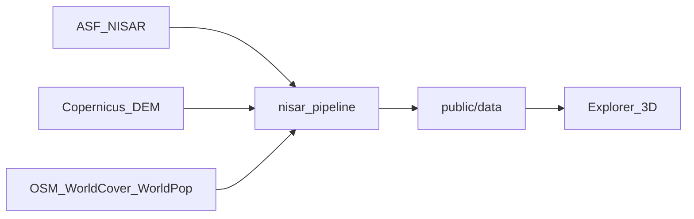

# Funciones del explorador NISAR

Referencia de comportamiento del proyecto **Dancing with the SARs**. Cada función de producción se describe en tres partes: **qué** produce, **cómo** lo calcula y **por qué** existe. Las funciones privadas que solo parten un cálculo van bajo la función que las llama.

La guía corta de uso sigue en [`README.md`](../README.md). Cómo regenerar los datos está en [`pipeline/README.md`](../pipeline/README.md).

## 1. Para qué existe el proyecto

Es un mapa 3D isométrico del Valle de Mexicali para el reto [Dancing with the SARs](https://www.spaceappschallenge.org/2026/challenges/dancing-with-the-sars/) de NASA Space Apps 2026. La persona pilota una nave sobre el terreno y ve, con radar NISAR, cómo cambia el suelo. El caso central es el hundimiento alrededor del campo geotérmico de Cerro Prieto.

Las capas de `public/data` son mediciones NISAR reales (productos PROVISIONAL, octubre 2025 a octubre 2026), más Copernicus DEM, ESA WorldCover 2021, WorldPop 2020 y OpenStreetMap.

El producto se obliga a decir estos límites, porque el dato los impone:

- Un año de mediciones, con ±2–3 cm de ruido por fecha aun después de suavizar.
- El radar mide en línea de vista: Acumulado y Velocidad mezclan movimiento vertical y horizontal.
- Las capas señalan patrones y exposición. Un cambio de radar no indica su causa ni confirma daños.
- El «Hundimiento 3D» a ×2 000, ×5 000 o ×10 000 es ilustrativo.
- En cultivos, la cobertura es de 2021 y no nombra el cultivo; la humedad es de los primeros centímetros, a unos 200 m; la cercanía al agua no demuestra riego y no se estima cosecha.

## 2. Cómo se reparte el trabajo

La app web no procesa SAR ni necesita credenciales de NASA Earthdata. El pipeline de Python, offline, convierte NISAR y el DEM en archivos estáticos. El explorador solo los lee.



| Carpeta | Rol |
|---|---|
| [`src/features/explorer/`](../src/features/explorer/) | Escena 3D (React Three Fiber), UI y análisis en el navegador |
| [`pipeline/`](../pipeline/) | Pipeline Python: descubre, recorta, invierte la red y exporta binarios |
| [`public/data/`](../public/data/) | Assets generados (`manifest.json`, `terrain.bin`, cubos, eventos, overlays) |
| [`openspec/`](../openspec/) | Propuestas, specs y tareas |

Los tests (`*.test.ts`, `pipeline/tests/`) comprueban este comportamiento. No están catalogados aquí porque no lo implementan. Los componentes de [`src/components/ui/`](../src/components/ui/) son primitivas de shadcn (botón, slider, switch, input, label, select, textarea). [`src/routeTree.gen.ts`](../src/routeTree.gen.ts) lo genera TanStack Router.

## 3. Arranque de la web

### [`src/routes/index.tsx`](../src/routes/index.tsx) — `Route`

**Qué:** monta el explorador en `/`.
**Cómo:** `createFileRoute("/")` con `ssr: false`, `component: Explorer` y `pendingComponent: ExplorerLoading`.
**Por qué:** WebGL no corre en el servidor (decisión D10). La escena se arma solo en el cliente.

### [`src/router.tsx`](../src/router.tsx) — `getRouter`

**Qué:** crea el router de la app.
**Cómo:** `createTanStackRouter` con el árbol de rutas, el contexto de React Query, restauración de scroll y precarga al pasar el cursor (`defaultPreload: "intent"`, `staleTime: 0`). Integra las queries con SSR.
**Por qué:** una sola fábrica de router para hidratar datos y rutas.

### [`src/routes/__root.tsx`](../src/routes/__root.tsx) — `Route` y `RootDocument`

**Qué:** documento HTML de la app: idioma, metadatos y scripts.
**Cómo:** `createRootRouteWithContext` define `head` (charset, viewport, título, descripción, `theme-color`, CSS). `RootDocument` pinta `<html lang="es" className="dark">`, el contenido, los scripts y, en desarrollo, las herramientas de TanStack.
**Por qué:** la página se presenta en español, en oscuro, como un explorador espacial del valle.

### [`src/env.ts`](../src/env.ts) — `env`

**Qué:** configuración tipada de Vite.
**Cómo:** `@t3-oss/env-core` + Zod; `SERVER_URL` opcional; `VITE_APP_TITLE` opcional; cadenas vacías se tratan como ausentes.
**Por qué:** un valor vacío no pisa el título por defecto.

### [`src/lib/utils.ts`](../src/lib/utils.ts) — `cn`

**Qué:** junta clases de Tailwind.
**Cómo:** `twMerge(clsx(inputs))`.
**Por qué:** las primitivas de shadcn combinan clases sin pelearse.

## 4. Estado

El estado vive en [`src/features/explorer/store.ts`](../src/features/explorer/store.ts), fuera de React, porque la escena 3D (60 fps) y los paneles leen lo mismo. Una sola vista de mapa a la vez.

Valores iniciales: región `mexicali`, reproducción encendida, vista `cumulative`, hundimiento 3D a ×10 000, oleaje encendido, overlays encendidos salvo que el usuario los apague. Factores de deformación: 2 000, 5 000, 10 000. Opacidad por defecto de capa: 0.85.

### `layerKey(regionId, layerId)`

**Qué:** clave estable para la UI de una capa.
**Cómo:** `` `${regionId}/${layerId}` ``.
**Por qué:** varias regiones comparten el mismo mapa de capas.

### `initialExplorerState(regionId?)`

**Qué:** estado de arranque.
**Cómo:** rellena `ExplorerState` con la región pedida y los valores por defecto.
**Por qué:** `setRegion` y los tests parten de un estado conocido.

### `createExplorerStore(initial?)`

**Qué:** store de TanStack con acciones que mutan el estado.
**Cómo:** `createStore` + `setState` que fusionan un parche. Acciones:

| Acción | Qué | Cómo | Por qué |
|---|---|---|---|
| `setRegion` | Cambia de zona de estudio | Si el id cambia, pone `dateIndex` en 0, reproduce, limpia sonda, inspector y cultivos | Cada región tiene su propia pila de fechas |
| `setLayerVisible` | Enciende o apaga una capa | Fusiona con `DEFAULT_LAYER` bajo `layerKey` | No hace falta sembrar todas las capas |
| `setLayerOpacity` | Opacidad de la capa | Recorta a [0, 1] | El usuario mezcla el raster con el relieve |
| `selectDate` | Fecha del slider | Redondea el índice, `playing: false` | Arrastrar el tiempo detiene el play |
| `advanceDate` | Un tick de reproducción | `(dateIndex + 1) % dateCount` | La línea de tiempo da la vuelta |
| `setPlaying` | Play / pausa | Asigna el booleano | Control de la línea de tiempo |
| `setProbe` | Posición y velocidad de la nave | Asigna `ProbeReading` o `null` | El HUD sigue a la nave |
| `setMapView` | Vista analítica activa | Asigna `MapView` | Una capa a la vez |
| `setView` | Vista y fecha juntas | `dateIndex = max(dateIndex, 0)` | Un evento abre su capa en su fecha |
| `setInspected` | Celda del inspector | Columna y fila o `null` | El toque del mapa es distinto de la sonda |
| `setEventsOpen` | Panel de eventos | Al abrir, cierra contexto y créditos | Un panel secundario a la vez |
| `setSettingsOpen` | Ajustes | Asigna el booleano | Los ajustes conviven con el vuelo |
| `setOverlay` | Camino, canal o río | `overlays[id] = on` | El usuario apaga un overlay; por defecto está encendido |
| `setDeform3d` / `setDeformFactor` | Hundimiento 3D ilustrativo | Factor restringido a 2 000 / 5 000 / 10 000 | El relieve exagerado se lee; el dato no |
| `setWaterMotion` | Oleaje y ondas | Asigna el booleano | La extensión del agua sigue la fecha; el oleaje es decorativo |
| `setWarping` | Transición entre regiones | Asigna el booleano | Cubre la carga al saltar de destino |
| `setContextOpen` / `setCreditsOpen` | Ayuda y créditos | Se excluyen entre sí y con eventos | Evitan paneles apilados |
| `setAgricultureOpen` | Panel de cultivos | Asigna el booleano | Cultivos no cambian la capa del mapa |
| `setAgriZone` | Zona agrícola elegida | Saca ese id de la lista de comparación | La zona principal no se compara consigo misma |
| `setAgriCompare` | Zonas a comparar | Asigna el arreglo | Hasta tres zonas en el panel |

El singleton `explorerStore` es el que usa la app.

### `overlayOn(state, id)`

**Qué:** dice si un overlay vectorial está encendido.
**Cómo:** `state.overlays[id] !== false`.
**Por qué:** falta la clave = encendido. El usuario solo registra los que apaga.

### `layerUi(state, layerId)`

**Qué:** visibilidad y opacidad de una capa.
**Cómo:** busca `layerKey`; si no hay entrada, `DEFAULT_LAYER`.
**Por qué:** el renderizador siempre recibe un estado completo.

## 5. Datos que entra la web

### Manifiesto — [`src/features/explorer/manifest.ts`](../src/features/explorer/manifest.ts)

Espeja el esquema v2 de [`pipeline/src/nisar_pipeline/manifest.py`](../pipeline/src/nisar_pipeline/manifest.py). Tipos de capa que la web pinta: `los-displacement` y `raster`.

#### `isSupported(type)` (privada)

**Qué:** comprueba si la web sabe pintar ese tipo.
**Cómo:** `SUPPORTED_LAYER_TYPES.includes(type)`.
**Por qué:** un tipo nuevo en el pipeline no tumba la app.

#### `parseManifest(input, warn?)`

**Qué:** valida `manifest.json` y devuelve regiones con capas pintables.
**Cómo:** `RawManifestSchema.parse`; por región filtra las capas con `isSupported` y avisa las omitidas.
**Por qué:** el pipeline puede añadir tipos; esta versión de la web los ignora.

### Carga — [`src/features/explorer/data/queries.ts`](../src/features/explorer/data/queries.ts)

Base: `/data`. Las queries son inmutables (`staleTime` y `gcTime` infinitos): los binarios no cambian en una sesión.

#### `decodeInt16(buffer, expectedLength)`

**Qué:** interpreta un ArrayBuffer como Int16 little-endian.
**Cómo:** exige `byteLength === expectedLength * 2` y construye `Int16Array`.
**Por qué:** un archivo truncado o de otro tamaño falla al cargar, no en el shader.

#### `fetchBinary(path, expectedLength)` (privada)

**Qué:** baja un `.bin` y lo decodifica.
**Cómo:** `fetch("/data/" + path)` → `decodeInt16`.
**Por qué:** terreno y cubos Int16 comparten el mismo cargador.

#### `manifestQuery`

**Qué:** opciones de React Query para `manifest.json`.
**Cómo:** fetch + `parseManifest`.
**Por qué:** un solo catálogo de regiones, capas, POIs y créditos.

#### `terrainQuery(region)`

**Qué:** plano de alturas Int16 (`width × height`).
**Cómo:** `fetchBinary` con esa longitud.
**Por qué:** la malla 3D vive en ese archivo.

#### `layerCubeQuery(region, layer)`

**Qué:** cubo de desplazamiento (`fechas × height × width`).
**Cómo:** `fetchBinary` con `dates.length * width * height`.
**Por qué:** todas las vistas de movimiento salen de este cubo.

#### `fetchRaster(region, layer)` (privada)

**Qué:** raster continuo (Int16) o categórico (Uint8).
**Cómo:** longitud `max(dates.length, 1) * plano`; Int16 por `fetchBinary`, Uint8 con comprobación de tamaño.
**Por qué:** uso de suelo, agua y humedad no caben en el cubo LOS.

#### `rasterQuery(region, layer)`

**Qué:** query bajo demanda de un raster.
**Cómo:** `skipToken` si no hay capa.
**Por qué:** solo se baja lo que la vista pide.

#### `fetchOverlay` / `overlayQuery`

**Qué:** features de caminos, canales o ríos.
**Cómo:** JSON en `overlay.path`.
**Por qué:** las cintas se drapean sobre el DEM.

#### `fetchEvents` / `eventsQuery`

**Qué:** lista de eventos de impacto.
**Cómo:** Zod (`ImpactEventSchema`: id, tipo, fecha, col/row, área, título, detalle). `skipToken` si la región no declara `events`.
**Por qué:** el storytelling de eventos es opcional por región.

### Grilla — [`src/features/explorer/lib/grid.ts`](../src/features/explorer/lib/grid.ts)

Convención: columna y fila fraccionarias, origen noroeste, fila 0 al norte. En la escena: `x = col`, `z = row`, `y = altura`.

#### `sampleBilinear(data, W, H, col, row, nodata?, offset?)`

**Qué:** valor interpolado entre centros de celda.
**Cómo:** desplaza a espacio de celda (`col - 0.5`, `row - 0.5`); si algún vecino es nodata, `NaN`; si no, media ponderada de cuatro esquinas.
**Por qué:** la sonda de la nave se mueve en continuo, no a saltos de 80 m.

#### `cellIndex(W, H, col, row)`

**Qué:** índice plano para leer un cubo.
**Cómo:** `floor`, recorte a la grilla, `j * W + i`.
**Por qué:** el inspector lee una celda en O(1).

#### `clampToGrid(col, row, W, H, margin?)`

**Qué:** mantiene la nave dentro del raster.
**Cómo:** recorta a `[margin, lado - margin]` y marca si recortó.
**Por qué:** un margen evita leer el borde sin vecinos.

#### `gridToLonLat(region, col, row)`

**Qué:** longitud y latitud de una celda.
**Cómo:** `u = col / width`, `v = row / height`; interpola las cuatro `corners` del manifiesto.
**Por qué:** el HUD muestra WGS84 sin una librería de proyección en cada frame.

#### `screenToWorld(right, forward)`

**Qué:** dirección WASD en la grilla isométrica.
**Cómo:** mezcla a 45° con `SQRT1_2`: `dx = right*s - forward*s`, `dz = -right*s - forward*s`; normaliza si la longitud > 1.
**Por qué:** «arriba» en pantalla es noroeste en el mapa.

## 6. Qué muestra el mapa y por qué

Una vista a la vez, agrupada por tema: Movimiento, Superficie, Agua, Impacto. El texto de cada capa mide un patrón. Afirmar la causa queda fuera del producto.

### Catálogo — [`src/features/explorer/lib/catalog.ts`](../src/features/explorer/lib/catalog.ts)

Temas: `movement` / `surface` / `water` / `impact`. Vistas de movimiento fijas: Acumulado, Velocidad, Zonas, Diferencial, Aceleración.

#### `displacementLayer(region)`

**Qué:** la capa LOS de la región.
**Cómo:** primera capa con `type === "los-displacement"`.
**Por qué:** las cinco vistas de movimiento salen de un solo cubo.

#### `rasterView(layerId)`

**Qué:** identificador de vista para un raster.
**Cómo:** `` `layer:${layerId}` ``.
**Por qué:** el selector trata igual un raster y una vista derivada.

#### `buildCatalog(region, minDatesAcceleration)`

**Qué:** menú de vistas disponibles.
**Cómo:** si hay cubo LOS, añade las cinco vistas de movimiento y desactiva Aceleración si hay menos de `minDatesAcceleration` fechas (4); luego cada raster por su tema.
**Por qué:** una región sin humedad no muestra esa fila.

#### `resolveView(catalog, view)`

**Qué:** la vista que de verdad se pinta.
**Cómo:** coincidencia habilitada → primera habilitada → `null`.
**Por qué:** al cambiar de región, una vista vieja no deja la pantalla en blanco.

#### `nearestDateIndex(dates, date)`

**Qué:** índice de la fecha más cercana.
**Cómo:** vacío → `-1`; sin fecha → última; si no, mínima diferencia absoluta de timestamps.
**Por qué:** un evento salta a su época en la línea de tiempo.

#### `continuousPlane(data, layer, plane, index)`

**Qué:** banda continua en unidades reales.
**Cómo:** offset `max(index, 0) * plane`; nodata → `NaN`; el resto `raw * scale`.
**Por qué:** el shader trabaja en cm, dB o m³/m³, no en Int16.

#### `categoricalPlane(data, plane, index)`

**Qué:** banda de clases.
**Cómo:** `subarray` de un plano.
**Por qué:** uso de suelo y agua van por valor entero.

#### `classColors(layer, fallback)`

**Qué:** paleta de 16 colores para el shader.
**Cómo:** rellena 16 con el fallback y pisa `classes[value]` si `value < 16`.
**Por qué:** el GLSL espera un arreglo de tamaño fijo.

#### `readLayer(layer, data, region, col, row, date)`

**Qué:** una línea de texto para el inspector.
**Cómo:** fecha más cercana, `cellIndex`; si es categórica, el nombre de la clase; si no, `toFixed(1)` + unidades.
**Por qué:** tocar el mapa dice qué mide esa celda, en palabras.

#### `sourceAt(layer, date)`

**Qué:** satélite de esa fecha.
**Cómo:** primer `segment` cuyo `until` cubre la fecha; si no hay segmentos, `layer.source`.
**Por qué:** la historia Sentinel-1 y NISAR se distinguen en los créditos.

#### `eventView(type)`

**Qué:** vista que corresponde a un tipo de evento.
**Cómo:** agua / disturbio / cambio → `layer:${type}`; el resto → `"zones"`.
**Por qué:** al tocar un evento, el mapa muestra la capa que lo detectó.

### Estadística del cubo — [`src/features/explorer/lib/stats.ts`](../src/features/explorer/lib/stats.ts)

Año de 365.25 días.

#### `velocityField(cube, info)`

**Qué:** cm/año por píxel.
**Cómo:** mínimos cuadrados ordinarios sobre fechas válidas: `years = (parse(d) - t0) / YEAR_MS`, `y = raw * scale`; pendiente `(n·sxy − sx·sy) / (n·sxx − sx²)` si hay al menos 2 puntos y el denominador no es 0.
**Por qué:** Velocidad resume toda la serie; no depende de la fecha del slider.

#### `robustLimit(values, q = 0.99)`

**Qué:** tope simétrico para la escala de color.
**Cómo:** ordena `|v|` finitos, toma el cuantil `q`, mínimo 0.1.
**Por qué:** unos pocos píxeles extremos no aplastan el mapa.

#### `fillForDisplay(cube, info, passes = 8)`

**Qué:** relleno de huecos solo para el relieve 3D.
**Cómo:** por fecha, dilata NaN con la media de 4 vecinos, hasta 8 pases o hasta que no cambie.
**Por qué:** un agujero de coherencia no debe abrir un precipicio vertical. El color del mapa sigue usando los NaN reales.

### Impacto — [`src/features/explorer/lib/impact.ts`](../src/features/explorer/lib/impact.ts)

Bandas en cm: alto ≤ −10, medio ≤ −5, bajo ≤ −2, subida ≥ +2. Zona mínima 1 km². Hasta 5 zonas etiquetadas. Radio de suavizado 2 celdas. Aceleración exige 4 fechas.

#### `classify(cm)`

**Qué:** banda de un píxel.
**Cómo:** escalera de umbrales; `NaN` → sin dato.
**Por qué:** shader, leyenda y etiquetas hablan el mismo código de color.

#### `boxSmooth(field, W, H, radius = 2)`

**Qué:** promedio de caja separable que ignora NaN.
**Cómo:** suma horizontal y luego vertical; un píxel NaN sigue NaN.
**Por qué:** el moteado de parcelas sueltas no inventa una «zona».

#### `datePlane(cube, info, dateIndex)`

**Qué:** plano de una fecha en cm.
**Cómo:** recorta el índice; nodata → `NaN`.
**Por qué:** Zonas y Diferencial se calculan sobre ese plano.

#### `zoneContext(zone, population, landcover, classNames)`

**Qué:** gente y uso de suelo dominantes de una zona.
**Cómo:** suma población > 0; moda de cobertura con conteo > 1.
**Por qué:** el impacto se cuenta en personas y en qué hay en el suelo, sin evaluar daño.

#### `zoneMap(smoothed, W, H, velocity, cellSizeM)`

**Qué:** componentes conexas de hundimiento o subida.
**Cómo:** clasifica; inunda 8-vecinos en bandas de bajada o de subida; área < 1 km² vuelve a «sin cambio»; guarda extremo y ordena por área.
**Por qué:** una parcela aislada de 80 m no es una zona accionable.

#### `differentialField(smoothed, W, H, cellSizeM)`

**Qué:** magnitud del gradiente en cm/km.
**Cómo:** diferencias centrales en el interior; `span = 2 * cellSizeM / 1000`; `hypot(dx, dz)`.
**Por qué:** señala dónde el cambio es más brusco, no cuánto se hundió el punto.

#### `accelerationField(cube, info)`

**Qué:** cambio de velocidad entre las dos mitades de la serie, o `null`.
**Cómo:** si hay al menos 4 fechas, parte en `floor((T-1)/2)`, calcula dos `velocityField` y resta; suaviza.
**Por qué:** un año da para comparar ritmos; menos de 4 fechas no.

#### `createImpactAnalysis(cube, info, velocity, cellSizeM)`

**Qué:** API memoizada de zonas, diferencial y aceleración.
**Cómo:** `Map` perezoso por índice de fecha; el límite diferencial se toma de la última fecha; aceleración una sola vez; límites con `robustLimit`.
**Por qué:** el play recorre T fechas sin recalcular O(W·H·T) cada frame.

#### `zoneReading` / `differentialReading` / `accelerationReading`

**Qué:** frase de la sonda para esa vista.
**Cómo:** banda → español; diferencial en «cm por km»; aceleración con umbral 0.5 cm/año² («sin cambio claro» / acelera / frena).
**Por qué:** el HUD habla en palabras, no en códigos de banda.

### Color — [`src/features/explorer/lib/colormap.ts`](../src/features/explorer/lib/colormap.ts)

#### `vik(t)`

**Qué:** color divergente (estilo Crameri) en [0, 1].
**Cómo:** interpola 9 paradas.
**Por qué:** hundimiento y subida se leen sin depender del rojo/verde clásico.

#### `symmetricLimit(valueRange)`

**Qué:** semirango centrado en cero.
**Cómo:** `max(|min|, |max|, 0.1)`.
**Por qué:** el cero (sin movimiento) queda en el centro de la leyenda.

#### `valueToT(value, limit)`

**Qué:** valor → [0, 1] en la paleta divergente.
**Cómo:** `0.5 - value / (2 * limit)`, recortado.
**Por qué:** negativo (alejarse del satélite) va al extremo cálido.

#### `sequential(t)` y `PALETTES`

**Qué:** rampa sin signo y paletas nombradas (`vik`, `heat`, `gray`, `greens`, `blues`).
**Cómo:** interpola paradas; `ramp(from, to)` fabrica las de un color.
**Por qué:** el manifiesto elige paleta por capa.

#### `colormapLut(size?, scale?)`

**Qué:** LUT RGBA para el GPU.
**Cómo:** `size` (256) entradas, RGB × 255, alfa 255.
**Por qué:** una textura 1D colorea todo el raster.

#### `toCss([r, g, b])`

**Qué:** `rgb()` para la leyenda HTML.
**Cómo:** redondea × 255.
**Por qué:** DOM y shader muestran el mismo color.

### Agua animada — [`src/features/explorer/lib/water.ts`](../src/features/explorer/lib/water.ts)

Clases: permanente = 2, nueva = 3. Umbral de dibujo 0.3 × 255. Kernel `[1, 2, 1]` (÷16). Máximo 8 ondas, una cada 0.35 s.

#### `blurPlane` (privada)

**Qué:** suaviza una máscara binaria a un canal.
**Cómo:** blur separable; escribe `round((sum/16)*255)`.
**Por qué:** el borde del agua no es un pixelado duro.

#### `waterMask(cube, W, H, dates)`

**Qué:** máscara RG de agua permanente (R) y nueva (G) por fecha.
**Cómo:** plano binario por clase → `blurPlane` en stride `plane * 2`.
**Por qué:** CPU y shader usan la misma máscara para sonda y oleaje.

#### `isWaterAt(mask, W, H, dateIndex, col, row)`

**Qué:** si esa celda es agua en esa fecha.
**Cómo:** compara R o G con el umbral.
**Por qué:** la nave solo levanta ondas sobre agua medida.

#### `waterDateIndex(dates, date)`

**Qué:** última fecha de agua ≤ la fecha del mapa.
**Cómo:** recorre `dates[i] <= date`.
**Por qué:** el cubo de agua es mensual; el cubo LOS tiene más fechas.

#### `createRipples` / `addRipple` / `shipRipple`

**Qué:** piscina fija de ondas y el spawn al navegar.
**Cómo:** `MAX_RIPPLES * 3` floats; anillo; `shipRipple` exige movimiento + agua y respeta el intervalo.
**Por qué:** el buffer del shader tiene tamaño fijo; el oleaje se apaga en Ajustes.

### Texto amable — [`src/features/explorer/lib/friendly.ts`](../src/features/explorer/lib/friendly.ts)

Tendencia en cm/año: estable si `|rate| < 1`, hacia el satélite si `rate > 0`, lento > −3, moderado > −8, si no rápido. Objetos de 0.5–40 cm para comparar tamaños. Zona muerta de velocidad: 0.5 celdas/s.

#### `trendLevel(rate)`

**Qué:** etiqueta cualitativa del hundimiento.
**Cómo:** escalera sobre una tasa finita.
**Por qué:** «moderado» se lee; «−6.2 cm/año» en el HUD de la nave se acompaña de esa palabra.

#### `sizeComparison(cm)`

**Qué:** metáfora cotidiana del desplazamiento.
**Cómo:** `|cm| < 0.1` no dice nada; elige el primer objeto cuyo tope cubre el valor, o «más que una regla».
**Por qué:** unos centímetros en un año se entienden junto a un lápiz o una mano.

#### `shipSpeedKmh(vx, vz, cellSizeM)`

**Qué:** velocidad de la nave en km/h, redondeada a centenas.
**Cómo:** `hypot`; si < 0.5 celdas/s → 0; si no, `round(celdas/s * cellSizeM * 3.6 / 100) * 100`.
**Por qué:** un número estable en el HUD, no un temblor de 3 km/h.

#### `compassHeading(vx, vz)`

**Qué:** rumbo de 8 puntos.
**Cómo:** `atan2(vx, -vz)` → octante. +x este, +z sur.
**Por qué:** el valle se nombra con norte/sur, no con ejes de Three.js.

#### `nearestPoi(pois, col, row, cellSizeM)`

**Qué:** el punto de interés más cercano y a cuántos km.
**Cómo:** mínima distancia en grilla; «Sobre» si < 1 km.
**Por qué:** la lectura se ancla a Cerro Prieto, Mexicali, el río.

#### `elapsedText(first, current)`

**Qué:** tiempo transcurrido en español.
**Cómo:** días del delta ISO; < 45 días en días; si no, meses/años con 30.44 días/mes.
**Por qué:** el slider dice «a los 8 meses», no solo la fecha ISO.

### Sonda de una celda — [`src/features/explorer/lib/probe.ts`](../src/features/explorer/lib/probe.ts)

#### `readSeries(cube, region, layer, col, row)`

**Qué:** serie temporal de esa celda, en cm o `null`.
**Cómo:** `cellIndex`; por fecha, nodata → `null`.
**Por qué:** el estado de la nave grafica el punto bajo los pies.

#### `linearRate(series, dates)`

**Qué:** cm/año de esa celda.
**Cómo:** OLS sobre puntos válidos, mismo año de 365.25 días que `velocityField`.
**Por qué:** la tendencia del HUD es la del píxel, no la de la zona.

### Picking — [`src/features/explorer/lib/pick.ts`](../src/features/explorer/lib/pick.ts)

#### `pickTerrain(origin, dir, heightAt, W, H, maxT)`

**Qué:** celda donde el rayo del clic corta el terreno.
**Cómo:** avanza `t` de 0.75 en 0.75; cuando `y <= heightAt(x, z)`, 12 pasos de bisección.
**Por qué:** un raycast contra ~500 000 triángulos no cabe en el clic.

### Infraestructura analítica — [`src/features/explorer/lib/infrastructure.ts`](../src/features/explorer/lib/infrastructure.ts)

#### `toSegments(features, cellSizeM)`

**Qué:** aristas de polilínea con longitud en km.
**Cómo:** cada par de puntos consecutivos; `km = hypot * cellSizeM / 1000`.
**Por qué:** el KPI «km de camino en zona que baja» suma estas aristas.

#### `affectedSegments(segments, W, H, bands, differential, differentialCut)`

**Qué:** qué tramos cruzan hundimiento o un diferencial alto.
**Cómo:** celda del punto medio; marca si `bands >= LOW` o `differential >= cut`; suma km.
**Por qué:** caminos y canales se resaltan donde el suelo se mueve.

#### `nearestSegment(segments, col, row, maxCells = 3)`

**Qué:** vía bajo el cursor.
**Cómo:** distancia punto-segmento; gana si < `maxCells`.
**Por qué:** un camino menor se ve al acercarse o al apuntarlo.

#### `arrowGrid(field, W, H, step, minValue = 0.5)`

**Qué:** flechas de movimiento este-oeste.
**Cómo:** mediana por bloque; omite bloques pobres; `|value| >= minValue`.
**Por qué:** un campo denso de flechas no se lee; este sí.

#### `arrowStep(zoom)`

**Qué:** paso de muestreo según el zoom.
**Cómo:** > 18 → 6; > 9 → 12; > 4 → 24; si no 48.
**Por qué:** al alejarse hay menos flechas.

### Cintas — [`src/features/explorer/lib/ribbon.ts`](../src/features/explorer/lib/ribbon.ts)

Estilos por clase de vía (ancho, distancia máxima visible, color). Fundido desde el 80 % de esa distancia. Límite de inglete 2.

#### `roadClass(name)`

**Qué:** índice de estilo.
**Cómo:** busca el nombre; si no, clase secundaria.
**Por qué:** OSM trae `motorway`…`path`; el ancho sigue el tipo.

#### `roadFade(cls, visibleCells, hit)`

**Qué:** opacidad 0–1 de una clase.
**Cómo:** 1 si está apuntada o no tiene tope; si no, smoothstep entre 0.8× y 1× `maxCells`.
**Por qué:** las vías menores aparecen al acercarse.

#### `buildRibbon(features, baseHeightAt, stepCells = 1)`

**Qué:** geometría GPU de todas las vías.
**Cómo:** subdivide; vértices a ±lado con inglete; `y = baseHeightAt`; índices de quads.
**Por qué:** el vector se drape sobre el DEM y se deforma con el hundimiento 3D.

Ayudas privadas: `smoothstep`, `subdivide`, `unitNormal`, `miter`.

#### `ribbonHits(segment, flags)`

**Qué:** atributo por vértice para resaltar tramos.
**Cómo:** `flags[segment[i]]`.
**Por qué:** un tramo en zona de cambio o el canal de la zona agrícola se pinta distinto.

### Modelos del mapa — [`src/features/explorer/lib/mapModels.ts`](../src/features/explorer/lib/mapModels.ts)

Clase cultivos = 5, urbana = 6. Variantes de cultivo con pesos (suma 40): alfalfa, trigo, algodón, etc. Tope: 7 000 cultivos, 3 000 edificios, 420 autos. Radio de clúster 2.

#### `cropVariant(seed)`

**Qué:** id de modelo de cultivo.
**Cómo:** `seed % CROP_WEIGHT` recorre los pesos.
**Por qué:** el valle se ve cultivado. El modelo es decorativo: WorldCover 2021 no nombra el cultivo.

#### `urbanCityMask(landcover, W, H, col, row)`

**Qué:** mancha urbana conexa cerca de un punto, o `null`.
**Cómo:** busca un píxel urbano en un anillo de 40 celdas; BFS de 4 vecinos solo urbano.
**Por qué:** las casas se concentran junto a Mexicali, no en cada píxel «zona urbana» del valle.

#### `isCropKind(kind)`

**Qué:** guarda de tipo para un id de cultivo.
**Cómo:** `CROP_VARIANTS.some`.
**Por qué:** el renderer distingue un trigo de una casa.

#### `placeMapModels(input)`

**Qué:** lista de modelos (cultivo, casa, edificio, auto) con col, row, yaw, escala.
**Cómo:** anclas en una grilla con stride; clústeres 1–5; anillos; autos cada N puntos de camino; recorta si pasa el tope. `hash` / `clusterSize` / `ring` / `onLand` / `placeCars` son privadas.
**Por qué:** instancing WebGL con un presupuesto fijo; el mapa se siente habitado.

## 7. Escena 3D

### Orquestación — [`src/features/explorer/Explorer.tsx`](../src/features/explorer/Explorer.tsx)

#### `Explorer`

**Qué:** puerta de WebGL.
**Cómo:** `hasWebGL2()` una vez; si falla, `NoWebGL`; si no, `ExplorerScene`.
**Por qué:** sin GPU 2 no se intenta cargar cubos.

#### `ExplorerLoading({ label? })`

**Qué:** pantalla de carga a pantalla completa.
**Cómo:** fondo `#05070f` y spinner.
**Por qué:** manifiesto, terreno y cubos tardan; la ruta lo usa como `pendingComponent`.

#### `fmtShortDate(iso)` (privada)

**Qué:** fecha corta en español de México, UTC.
**Cómo:** `toLocaleDateString("es-MX")` con mediodía Z.
**Por qué:** evita el salto de día por zona horaria.

#### `timelineNote(view, deform3d)` (privada)

**Qué:** nota bajo el slider.
**Cómo:** solo en Velocidad y Aceleración; si el relieve 3D está encendido, aclara que el relieve sí sigue la fecha.
**Por qué:** esas vistas son de toda la serie; el slider parece «roto» si nadie lo explica.

#### `nearestModel(models, kind, probe)` (privada)

**Qué:** el modelo de cultivo de esa clase más cercano a la nave.
**Cómo:** distancia euclídea en grilla; sin sonda, el del medio.
**Por qué:** elegir «trigo» en el panel vuela hacia un grupo visible.

#### `ExplorerScene` (privada)

**Qué:** raíz que carga datos, arma análisis y pinta Canvas + HUD.
**Cómo:** TanStack Query (manifiesto, terreno, cubos, rasters, eventos, overlays); `buildCatalog` + `createImpactAnalysis`; `heightAt` suma DEM y, si `deform3d`, el cubo rellenado × factor; `FlightContext`; warp de región 450 ms de salida y 400 ms de entrada; POI por defecto `cerro-prieto`; capa de UI `main`; exageración vertical 3.
**Por qué:** un solo sitio conecta dato, vuelo y paneles. El estado de vuelo (`Flight`) vive en un objeto mutable (D9): 60 fps sin re-render de React.

### Escena — [`src/features/explorer/scene/Scene.tsx`](../src/features/explorer/scene/Scene.tsx)

#### `ProbePublisher` (privada)

**Qué:** publica la sonda al store ~10 Hz.
**Cómo:** `useFrame` acumula 0.1 s; redondea col/row a 0.1; omite si no cambió posición ni movimiento; `gridToLonLat` + `setProbe`.
**Por qué:** el HUD no puede re-renderizar 60 veces por segundo.

#### `Scene(props)`

**Qué:** grafo 3D: cielo, luces, cámara, terreno, overlays, nave.
**Cómo:** estrellas (quietas si hay menos movimiento); `IsoCamera`; `Terrain` con uniforms compartidos; marcadores; `Infrastructure` por overlay; flechas, contorno agrícola, modelos, `Ship`, `ProbePublisher`.
**Por qué:** un diorama, no una colección de Canvas sueltos.

### Geometría del terreno — [`src/features/explorer/scene/terrainGeometry.ts`](../src/features/explorer/scene/terrainGeometry.ts)

Constantes: exageración 3; `MAP_SCALE` 3 (la nave se lee sobre una grilla grande); altura de vuelo `48 / MAP_SCALE`.

#### `verticalScale(region, exaggeration)`

**Qué:** metros de DEM → unidades Y de la escena.
**Cómo:** `exaggeration / cellSizeM`.
**Por qué:** 1 unidad de escena = 1 celda en planta; el relieve se lee en isométrico.

#### `baseHeightFn(region, heights, exaggeration)`

**Qué:** altura del DEM en (col, row).
**Cómo:** `sampleBilinear(heights) * verticalScale`.
**Por qué:** caminos y cinta se drapean sobre el suelo real, no sobre el hundimiento 3D.

#### `hypsoColor(h)`

**Qué:** tinte hipsométrico del desierto.
**Cómo:** paradas lineales; `h === 0` usa color de agua.
**Por qué:** el valle se distingue del mar y de las sierras sin una textura satelital.

#### `buildTerrain(region, heights, exaggeration, step = 1)`

**Qué:** malla de superficie + faldón.
**Cómo:** vértices en centros de celda; UV de grilla para el shader; `step > 1` decima (móvil); faldón al perímetro hasta `minY - 12`.
**Por qué:** el mapa parece un diorama; en móvil hay menos triángulos.

### Material — [`src/features/explorer/scene/layerMaterial.ts`](../src/features/explorer/scene/layerMaterial.ts)

Sentinel de nodata: −9999. Modos: cubo, campo divergente, campo secuencial, bandas.

#### Texturas: `fieldTexture`, `bandsTexture`, `cubeTexture`, `deformCubeTexture`, `waterTexture`

**Qué:** suben campos, clases, cubo LOS, cubo de deformación y máscara de agua al GPU.
**Cómo:** `DataTexture` / `DataArrayTexture`; nodata → sentinel; deformación pone NaN en 0; agua con filtro lineal.
**Por qué:** el fragment shader pinta sin bajar a JS por píxel.

#### `bandColors(colors)` / `paletteLut(palette)`

**Qué:** 16 colores de clase y LUT de paleta.
**Cómo:** rellena a 16; LUT de 256 con `colormapLut`.
**Por qué:** tamaño fijo en GLSL.

#### `createLayerUniforms()`

**Qué:** bag de uniforms con cubos vacíos y huecos para ondas.
**Cómo:** opacidades por defecto, `MAX_RIPPLES` slots.
**Por qué:** terreno y cintas de infraestructura comparten el mismo objeto: el hundimiento 3D coincide.

#### `createTerrainMaterial(uniforms)`

**Qué:** `MeshStandardMaterial` con shader a medida.
**Cómo:** `onBeforeCompile` deforma Y y normales; el fragmento mezcla modo de pintura, agua, ondas, overlay agrícola/ciudad y brillo.
**Por qué:** una sola pasada pinta dato + agua + selección de zona.

### Terreno React — [`src/features/explorer/scene/Terrain.tsx`](../src/features/explorer/scene/Terrain.tsx)

#### `Terrain(...)`

**Qué:** mallas de terreno y actualización de uniforms cada frame.
**Cómo:** `buildTerrain` + `createTerrainMaterial`; efectos suben texturas; cruce de fechas en 2 s; `useFrame` pone modo, opacidad, deformación, pulso de ciudad, tiempo de agua y ondas (velocidad mínima 0.5; un tap vía `flight.tap`).
**Por qué:** el dato llega al GPU aquí; las cintas leen los mismos uniforms.

### Vuelo — [`src/features/explorer/scene/flight.ts`](../src/features/explorer/scene/flight.ts)

Velocidad máxima `38 / MAP_SCALE` celdas/s; turbo ×2; aceleración `90 / MAP_SCALE`; fricción 3.5; margen de borde 1 celda.

#### `createFlight()` / `FlightContext` / `useFlight()`

**Qué:** estado mutable de la nave y su contexto React.
**Cómo:** objeto con col, row, y, vx, vz, rumbo, alabeo, destino, tap, snap; el hook lanza si falta el provider.
**Por qué:** el loop de `useFrame` escribe aquí, no en `setState`.

#### `teleport(f, col, row)`

**Qué:** coloca la nave de golpe.
**Cómo:** limpia destino y velocidad; `y = heightAt + HOVER_HEIGHT`; `snap = true`.
**Por qué:** al cargar la región o al llegar a un POI, la cámara no interpola desde el otro valle.

#### `stepFlight(f, { dx, dz, boost }, dt)`

**Qué:** integra un paso de movimiento.
**Cómo:** el teclado cancela el destino; si hay destino, dirige hacia él; fricción; tope de velocidad; rebote en el margen.
**Por qué:** WASD y «clic para volar ahí» comparten la misma física.

### Nave — [`src/features/explorer/scene/Ship.tsx`](../src/features/explorer/scene/Ship.tsx)

#### `Ship({ keys, reducedMotion })`

**Qué:** modelo de la nave, luz, línea al suelo y estela.
**Cómo:** `useFrame` limita dt a 1/20 s; `screenToWorld` + `stepFlight`; suaviza Y a `HOVER_HEIGHT`; rumbo y alabeo; escala `2.2 / MAP_SCALE`. Internos: `Outlined` (contorno oscuro), `ShipModel`, `GroundLine` (anillo + línea), `ShipTrail` (48 puntos, se reinicia en `snap`).
**Por qué:** la nave es la sonda. El usuario ve dónde está midiendo.

### Cámara — [`src/features/explorer/scene/IsoCamera.tsx`](../src/features/explorer/scene/IsoCamera.tsx)

#### `IsoCamera({ regionSize, reducedMotion, onPick })`

**Qué:** ortográfica isométrica que sigue a la nave, con zoom y clic.
**Cómo:** acimut π/4, elevación `atan(1/√2)`, distancia 900; rueda o pellizco → `zoomGoal`; un clic ≤ 6 px llama `pickTerrain`, pone `flight.target` y `tap`, y dispara `onPick`.
**Por qué:** navegación de «juego» sobre un mapa científico, con el mismo clic para inspeccionar.

### Infraestructura 3D — [`src/features/explorer/scene/Infrastructure.tsx`](../src/features/explorer/scene/Infrastructure.tsx)

#### `Infrastructure({ features, kind, flags, baseHeightAt, terrain })`

**Qué:** cintas de camino, canal o río.
**Cómo:** `buildRibbon`; GLSL comparte deformación con el terreno; `aHit` de `ribbonHits`; doble malla (canto + relleno); ancho según zoom; fundido por celdas visibles; flujo animado en agua; sin raycast.
**Por qué:** se ve la red y se ve qué tramos cruzan cambio. El canal de la zona agrícola se marca en amarillo desde las flags.

### Modelos instanciados — [`src/features/explorer/scene/MapModels.tsx`](../src/features/explorer/scene/MapModels.tsx)

#### `MapModels({ models, heightAt, focus })`

**Qué:** cultivos, casas, edificios y autos sobre el terreno.
**Cómo:** `usePlaced` arma matrices; `Part` es un `InstancedMesh`; geometrías procedurales por cultivo; el foco escala ×1.7 el elegido y ×0.35 el resto. `solidGeometry` elige la forma. `raycast` vacío.
**Por qué:** miles de instancias; no son «la verdad» del SAR.

### Flechas, contorno, marcadores, etiquetas

#### [`MotionArrows.tsx`](../src/features/explorer/scene/MotionArrows.tsx) — `MotionArrows`

**Qué:** conos de movimiento este-oeste.
**Cómo:** `arrowGrid` + `arrowStep`; escala `|value|/limit`; tope 1 500 instancias; elevación 2.
**Por qué:** la capa este-oeste se lee en dirección, no solo en color.

#### [`AgriculturalOutline.tsx`](../src/features/explorer/scene/AgriculturalOutline.tsx) — `AgriculturalOutline`

**Qué:** borde verde de la zona de cultivo elegida.
**Cómo:** aristas de la máscara; Y = `heightAt + 0.65`; pulso salvo `prefers-reduced-motion`.
**Por qué:** el panel de cultivos y el mapa señalan el mismo polígono.

#### [`PoiMarkers.tsx`](../src/features/explorer/scene/PoiMarkers.tsx) — `PoiMarkers`

**Qué:** faros 3D de destinos.
**Cómo:** cilindro y anillo ámbar a `20 / MAP_SCALE`; cada frame `placeLabel` proyecta el DOM.
**Por qué:** el nombre clicable vive en HTML; el ancla, en 3D.

#### [`ZoneMarkers.tsx`](../src/features/explorer/scene/ZoneMarkers.tsx) — `ZoneMarkers`

**Qué:** faros en el extremo de cada zona de hundimiento.
**Cómo:** color `BAND_COLORS[zone.band]`; la clave de etiqueta es el rango, estable al cambiar la fecha.
**Por qué:** las etiquetas no se remontan cada tick del play.

#### [`placeLabel.ts`](../src/features/explorer/scene/placeLabel.ts) — `placeLabel(el, point, camera, size)`

**Qué:** proyecta un punto 3D a un `translate3d` en pantalla.
**Cómo:** `project`; oculta si el NDC sale de ±1.05.
**Por qué:** las etiquetas HTML siguen a la cámara sin un `Html` de drei por cada una.

### Teclado — [`src/features/explorer/controls/useKeyboard.ts`](../src/features/explorer/controls/useKeyboard.ts)

#### `useKeyboard()`

**Qué:** ejes de movimiento en un ref para el loop de animación.
**Cómo:** `e.code` (WASD por posición física, también en AZERTY); flechas con `preventDefault`; Shift = turbo; ignora si el foco está en input, textarea, select, contentEditable o `role=slider`; limpia al perder el foco.
**Por qué:** el slider de tiempo usa flechas; la nave no debe robárselas. El ref evita re-renders.

Ayudas privadas: `keyCode`, `isTyping`.

### Medios — [`src/features/explorer/hooks/useMedia.ts`](../src/features/explorer/hooks/useMedia.ts)

#### `usePrefersReducedMotion()`

**Qué:** si el sistema pide menos movimiento.
**Cómo:** `matchMedia("(prefers-reduced-motion: reduce)")`.
**Por qué:** oleaje, estela, pulsos y warp se apagan.

#### `useIsCompact()`

**Qué:** UI compacta (móvil o puntero grueso).
**Cómo:** `max-width: 767px` o `pointer: coarse`.
**Por qué:** dock inferior y terreno decimado.

#### `hasWebGL2()`

**Qué:** si hay contexto `webgl2`.
**Cómo:** crea un canvas y pide el contexto.
**Por qué:** `Explorer` decide el fallback antes de cargar datos.

`useMediaQuery` (privada) es el matcher con fallback para SSR.

## 8. Interfaz

Paneles de vidrio (`Panel` / `PanelTitle` en [`ui/Panel.tsx`](../src/features/explorer/ui/Panel.tsx)): contenedor redondeado, fondo pizarra semitransparente. Jerarquía visual compartida.

### [`TopBar.tsx`](../src/features/explorer/ui/TopBar.tsx) — `TopBar`

**Qué:** título y botones de herramientas en escritorio.
**Cómo:** en compacto, una tira; en escritorio, título + `HudButton` (Cultivos solo si hay callback).
**Por qué:** la marca y los paneles caben sin tapar el mapa.

### [`MobileDock.tsx`](../src/features/explorer/ui/MobileDock.tsx) — `MobileDock`

**Qué:** barra inferior de iconos.
**Cómo:** `nav` horizontal, blancos de 44 px.
**Por qué:** el pulgar reemplaza la fila de `HudButton`.

### [`LayerPanel.tsx`](../src/features/explorer/ui/LayerPanel.tsx)

#### `LayerPanel`

**Qué:** selector por tema, ayuda «?» y leyenda.
**Cómo:** filtra `THEMES`; `VIEW_HELP` y la descripción de la capa; `Legend` si la capa está visible.
**Por qué:** «qué estoy viendo» es la pregunta principal del mapa.

#### `Segmented`

**Qué:** grupo de botones excluyentes.
**Cómo:** `aria-pressed`; opcionalmente 3 columnas.
**Por qué:** eventos, ajustes y capas comparten el mismo control.

#### `Legend`

**Qué:** muestras y degradados de la vista activa.
**Cómo:** raster categórico o continuo; bandas de zonas; textos de diferencial/aceleración/acumulado/velocidad. Internos: `RasterLegend`, `Bar`, `NoDataKey`.
**Por qué:** la escala se lee junto al mapa, no en un PDF.

### [`Timeline.tsx`](../src/features/explorer/ui/Timeline.tsx) — `Timeline`

**Qué:** play/pausa y slider de fechas.
**Cómo:** cada 3 000 ms llama `onAdvance` si `playing && ready`.
**Por qué:** el cubo se anima a un ritmo que se puede seguir con la vista.

### [`DateTitle.tsx`](../src/features/explorer/ui/DateTitle.tsx) — `DateTitle`

**Qué:** titular grande de la fecha.
**Cómo:** `key={date}` para reentrar la animación CSS; `aria-live` educado cuando no hay play.
**Por qué:** la fecha es el ancla narrativa de la escena.

### [`EventsList.tsx`](../src/features/explorer/ui/EventsList.tsx) — `EventsList`

**Qué:** catálogo de eventos por tipo.
**Cómo:** grupos; filtro `Segmented`; atajo «el más grande»; al elegir, `onSelect`.
**Por qué:** un evento vuela la nave, cambia la capa y la fecha. Son cambios medidos.

Ayudas: `shortLabel`, `fmt`, `largest`.

### [`AgriculturePanel.tsx`](../src/features/explorer/ui/AgriculturePanel.tsx) — `AgriculturePanel`

**Qué:** lista de zonas, humedad, comparación y contexto de agua.
**Cómo:** lista desplazable; tabla de humedad alineada por fecha; textos de `AGRI_COPY`.
**Por qué:** cultivos es un panel, no una capa que pisa el movimiento.

### [`Inspector.tsx`](../src/features/explorer/ui/Inspector.tsx) — `Inspector`

**Qué:** lectura de todas las capas en la celda tocada.
**Cómo:** lista de definición (`place`, coords, `rows`).
**Por qué:** un toque responde «qué dice cada capa de este lugar».

### [`ShipStatus.tsx`](../src/features/explorer/ui/ShipStatus.tsx) — `ShipStatus`

**Qué:** tablero de la nave: tendencia, tamaño, rumbo, POI, lectura de la vista.
**Cómo:** `readSeries` + `linearRate`; `nearestPoi`; km/h y brújula. Compacto = una línea. Internos: `TrendChip`, `Readout`.
**Por qué:** volar es medir. El tablero traduce el píxel bajo la nave.

### [`PoiList.tsx`](../src/features/explorer/ui/PoiList.tsx) — `PoiList`

**Qué:** destinos (regiones y POIs).
**Cómo:** compacto = chips; escritorio = lista con pista de warp.
**Por qué:** saltar a Cerro Prieto o a otra región es un destino, no un menú de capas.

### [`PoiLabels.tsx`](../src/features/explorer/ui/PoiLabels.tsx) / [`ZoneLabels.tsx`](../src/features/explorer/ui/ZoneLabels.tsx)

**Qué:** nombres HTML sobre el canvas, sincronizados con los faros 3D.
**Cómo:** registran refs en el mapa que `placeLabel` mueve; zonas muestran banda, velocidad, gente y uso de suelo.
**Por qué:** un botón accesible sobre un punto 3D.

### [`ModelsPanel.tsx`](../src/features/explorer/ui/ModelsPanel.tsx)

#### `MODEL_CATALOG`

**Qué:** ocho cultivos con archivo GLB, etiqueta y «por qué está aquí».
**Cómo:** apunta a `public/models/crops`.
**Por qué:** el panel enseña que son ilustrativos.

#### `ModelsPanel`

**Qué:** selector, conteos y vista previa 3D.
**Cómo:** botones en grilla; `ModelView` (Canvas mini, `useGLTF`, `FitModel` a 1.5, `Spin` a 0.55 rad/s, `PreviewBoundary` si el GLB falla).
**Por qué:** ver el modelo y volar hacia un grupo del mapa.

### [`SettingsDialog.tsx`](../src/features/explorer/ui/SettingsDialog.tsx) — `SettingsDialog`

**Qué:** visibilidad, opacidad, hundimiento 3D, overlays, oleaje.
**Cómo:** `Switch`, `Slider`, `Segmented` de factores.
**Por qué:** carga visual y honestidad del dato (el oleaje se apaga; la extensión del agua no).

### [`Overlays.tsx`](../src/features/explorer/ui/Overlays.tsx)

| Componente | Qué | Cómo | Por qué |
|---|---|---|---|
| `DataNotice` | Aviso si la fuente no es NISAR | Mapa `SOURCE_NOTICE` + `InfoHint` | Transparencia de procedencia |
| `SidePanel` | Hoja lateral no modal | `role="complementary"`; no atrapa el teclado | Se vuela mientras se lee |
| `ContextContent` | Ayuda larga de SAR e InSAR | JSX estático | Jueces y público entienden el dato |
| `CreditsContent` | Atribuciones y lista de productos | Créditos deduplicados; NISAR en `<details>` | El manifiesto trae la atribución |
| `WarpOverlay` | Fundido al cambiar de región | Clases CSS; variante reduced-motion | Cubre la carga |
| `ControlsHint` | Leyenda de controles | Teclado o táctil según `compact` | Primer minuto de uso |
| `NoWebGL` | Página de fallback | `Panel` + `ContextContent` | La historia se lee sin GPU |

### [`InfoHint.tsx`](../src/features/explorer/ui/InfoHint.tsx) — `InfoHint`

**Qué:** popover de ayuda «?».
**Cómo:** Radix, disparador `CircleHelp`, contenido arriba.
**Por qué:** cada capa tiene su límite dicho al lado del nombre.

## 9. Cultivos

[`src/features/explorer/lib/agriculture.ts`](../src/features/explorer/lib/agriculture.ts) parte la clase Cultivos de WorldCover 2021 (valor 5) en zonas. Constantes: zona mínima 1 km²; se parte a partir de 25 km² en teselas de 16 celdas; lista de 12; comparación de 3; vía de agua a lo sumo a 2 000 m; vegetación ±3 dB de HV; señal si una clase cubre ≥ 10 %; anillo de agua de 1 celda.

El panel no nombra el cultivo, no estima cosecha y no trata la cercanía al agua como riego. `AGRI_COPY` lo dice en la UI.

#### `listHelp(omitted)`

**Qué:** texto de la lista.
**Cómo:** plantilla con topes y, si se omitieron zonas, avisa que hay más en el mapa.
**Por qué:** estas zonas no son las de hundimiento.

#### `barrierMask(W, H, features)`

**Qué:** celdas de camino o canal que cortan cultivos.
**Cómo:** DDA a lo largo de cada segmento (`ceil(hypot * 4)` pasos).
**Por qué:** un canal entre parcelas son dos zonas, no una.

#### `buildZones(landcover, W, H, cellSizeM, barriers)`

**Qué:** mapa de zonas agrícolas (id, área, centroide, celdas).
**Cómo:** máscara cultivo y no barrera; inundación 4-vecinos (`flood`); si el área > 25 km², tesela (`splitLarge` / `pieceOf`); descarta < 1 km²; ordena; `owner` por celda.
**Por qué:** una mancha de 200 km² no cabe en una lista de 12.

#### `listedZones(zones, cap = 12)`

**Qué:** las primeras zonas y si se omitieron otras.
**Cómo:** `slice` + flag `omitted`.
**Por qué:** el resto se elige tocando el mapa.

#### `zoneAt(map, landcover, W, col, row)`

**Qué:** zona bajo un toque, o `null`.
**Cómo:** la celda es `CROP_CLASS` y `owner >= 0`.
**Por qué:** tocar un camino no selecciona cultivo.

#### `cropMask(owner, selectedId)` / `outlineMask(cells, W, H)`

**Qué:** clases 0/1/2 para el shader y el borde de la zona.
**Cómo:** 2 = elegida, 1 = otra zona de cultivo; borde si un vecino está fuera.
**Por qué:** el mapa destaca la selección sin cambiar la capa de movimiento.

#### `moistureSeries(cells, cube, dateCount, plane, scale, nodata)`

**Qué:** humedad media de la zona por fecha.
**Cómo:** media de celdas válidas (`meanAt` privada).
**Por qué:** SME2 es un proxy de los primeros centímetros, no un balance hídrico.

#### `vegetationWord` / `changeWord` / `disturbanceWord`

**Qué:** frases («más intensa», «señal más fuerte», «la superficie se disturbó»).
**Cómo:** HV a ±3 dB entre la primera fecha y la actual; cambio y disturbio si una clase cubre ≥ 10 % (`classShare`).
**Por qué:** un dB de radar no es un diagnóstico agronómico; la palabra es cualitativa.

#### `withComparison(selected, extras, candidate)`

**Qué:** lista de comparación con tope 3 y sin duplicados.
**Cómo:** la elegida primero; el candidato entra si cabe.
**Por qué:** tres series se leen; seis no.

#### `alignSeries(groups)`

**Qué:** columnas de humedad alineadas a la unión de fechas.
**Cómo:** fechas ordenadas; huecos en `null`.
**Por qué:** las zonas se comparan en el mismo eje temporal.

#### `nearestWaterway(cells, W, cellSizeM, sources)`

**Qué:** canal o río nombrado más cercano, o `null`.
**Cómo:** mínima distancia punto-segmento (`pointSegmentDistance`) sobre las celdas de la zona; tope 2 000 m.
**Por qué:** contexto. La copia dice que cercanía no es riego.

#### `paintWayFlags(base, segments, feature)`

**Qué:** flags para pintar de amarillo la vía de esa zona.
**Cómo:** pone 2 donde el segmento pertenece al feature.
**Por qué:** el mapa y el panel señalan el mismo canal.

#### `waterBeside(cells, plane, W, H)` / `noWayText` / `waterLines`

**Qué:** si hay agua permanente o nueva al lado, y las frases del panel.
**Cómo:** anillo de 1 celda; clases 2 y 3; `waterLines` junta distancia, toque de agua y descargos.
**Por qué:** el texto sale siempre con el límite del dato.

## 10. Pipeline

Orden de ejecución:

```
cli.main
  → load_config
  → build.run
       por región:
         make_grid
         planner (plan_nisar | plan_synthetic)
         fit_grid_to_budget
         load_dem
         plan.build  (NISAR: discover → fetch_subsets → build_series)
         extend_with_history  (opcional; apagado en la config actual)
         encode_* / write_bin
         subsidence_events
         build_extras
         class_events
       write_manifest
```

La CLI: [`pipeline/src/nisar_pipeline/cli.py`](../pipeline/src/nisar_pipeline/cli.py).

### `build_parser` / `main`

**Qué:** argumentos `--config`, `--synthetic`, `-v` y el código de salida.
**Cómo:** carga `regions.yaml`; si `--synthetic`, `plan_synthetic`; si no, `plan_nisar`; `run`; cualquier excepción se imprime y sale 1.
**Por qué:** el modo sintético desarrolla el frontend sin Earthdata. El manifiesto marca `source: "synthetic"` y la web avisa. No se entrega así.

### Configuración — [`config.py`](../pipeline/src/nisar_pipeline/config.py)

#### `_check_bbox(bbox)`

**Qué:** valida un bbox WGS84.
**Cómo:** longitudes −180…180, latitudes −90…90, min < max.
**Por qué:** un bbox invertido se detecta al cargar YAML, no a mitad de una descarga.

#### Modelos Pydantic: `Poi`, `StackConfig`, `HistoryConfig`, `LayerConfig`, `RegionConfig`, `PipelineConfig`

**Qué:** contrato de `regions.yaml`.
**Cómo:** ids `^[a-z0-9-]+$`; `ionosphere_correction` por defecto `false`; `coherence_threshold` 0.3; `deramp_exclude_km`; `RegionConfig._check` exige fechas crecientes, POIs y `reference_bbox` dentro del bbox; `PipelineConfig._unique` impide ids de región duplicados.
**Por qué:** restar la ionosfera par a par acumuló error y borró la señal de Cerro Prieto. El radio de deramp evita absorber el cuenco al quitar el plano.

#### `load_config(path)`

**Qué:** YAML → `PipelineConfig` con rutas absolutas.
**Cómo:** `yaml.safe_load` + `model_validate`; `output_dir` y `cache_dir` relativos al YAML.
**Por qué:** se corre desde cualquier cwd.

### Grilla — [`grid.py`](../pipeline/src/nisar_pipeline/grid.py)

#### `Grid`

**Qué:** celdas cuadradas en UTM (por defecto EPSG:32611).
**Cómo:** `transform` Affine de origen noroeste; `bounds` en metros; `lonlat_to_colrow`; `corner_lonlat` para el manifiesto; `coarsened(factor)` misma extensión, celdas más grandes.
**Por qué:** terreno, cubos y overlays comparten índices.

#### `_to_proj` / `_to_geo` / `make_grid(bbox, crs, max_size)`

**Qué:** transformers y la grilla que envuelve el bbox.
**Cómo:** proyecta las cuatro esquinas; el lado mayor tiene `max_size` celdas (512 por defecto).
**Por qué:** celdas cuadradas en metros, no en grados.

### Orquestación — [`build.py`](../pipeline/src/nisar_pipeline/build.py)

#### `plan_synthetic(cfg, region, layer)`

**Qué:** plan de capa con DEM real y cubo sintético.
**Cómo:** fechas cada 24 días; centro en POI `cerro-prieto` o centro del bbox; `build` llama `synthetic_subsidence`.
**Por qué:** el relieve es Copernicus; el hundimiento es un cuenco gaussiano para desarrollar UI.

#### `build_region(cfg, region, planner, dem_loader)`

**Qué:** todos los assets de una región y su entrada de manifiesto.
**Cómo:** grilla → presupuesto → DEM → por capa `plan.build` → cubo Int16 → eventos de hundimiento → extras → eventos de clase → `events.json` → POIs en col/row → `mf.Region`. El rango de color usa percentiles 0.1–99.9. `EVENT_SPECS` liga agua (clase 3, 1 km²), disturbio (clase 2, 3 km²) y cambio (clase 2, 1 km²).
**Por qué:** un fallo de una extra se registra y el resto sigue (`build_extras`). El presupuesto cabe en la web (~52 MB configurados).

#### `run(cfg, planner, dem_loader)`

**Qué:** construye todas las regiones y escribe `manifest.json`.
**Cómo:** lista de `build_region` + `write_manifest`.
**Por qué:** un manifiesto, varias regiones.

#### `_stable_timestamp(existing, regions, projection)`

**Qué:** `generatedAt` estable si el contenido no cambió.
**Cómo:** compara `projection` + `regions` serializados; si coinciden, reutiliza el timestamp viejo.
**Por qué:** re-ejecutar con los mismos datos da archivos idénticos.

### Descubrimiento — [`discover.py`](../pipeline/src/nisar_pipeline/discover.py)

No pide credenciales. Busca en ASF.

#### `Product` / `Discovery`

**Qué:** un GUNW y el resultado de la búsqueda (criterios, stacks, elegido, productos).
**Cómo:** `Discovery.dates` une ref y sec; `to_json` para el reporte.
**Por qué:** el reporte en `.cache` se puede auditar.

#### `_asf_search` / `_wkt` / `_to_product`

**Qué:** llama `asf_search`, arma el WKT del bbox, parsea un resultado a `Product`.
**Cómo:** fechas del nombre `_YYYYMMDDT`; cobertura = intersección / área; `covers_center` con el punto de Cerro Prieto.
**Por qué:** un stack que cubre media región pierde frente a uno completo.

#### `discover(region, layer, center, search_fn)`

**Qué:** elige stack y un producto por par (el de procesamiento más reciente).
**Cómo:** filtra polarización y fechas; agrupa por (órbita, frame) que cubren el centro; si `layer.stack` está fijado, lo usa; si no, maximiza `pares * cobertura`. Error explícito si no hay productos.
**Por qué:** Mexicali usa 85/72 descendente (principal) y 106/18 ascendente (vertical / este-oeste). Stacks 5/18 y 157/72 se descartaron por cobertura o pocos pares.

#### `write_report(disc, path)`

**Qué:** `discovery.json` en caché.
**Cómo:** JSON indentado.
**Por qué:** se revisa la cobertura a mano antes de volver a bajar.

### Descarga — [`download.py`](../pipeline/src/nisar_pipeline/download.py)

No se bajan los HDF5 completos (~2 GB). Lectura por rangos HTTPS. Las credenciales no se loguean ni se escriben.

#### `credential_source` / `require_credentials`

**Qué:** `'environment'`, `'netrc'` o error con instrucciones.
**Cómo:** token o usuario+contraseña; si no, `~/.netrc` para `urs.earthdata.nasa.gov`. Devuelve la fuente, nunca el secreto.
**Por qué:** aborta antes de tocar la red.

#### `earthdata_opener(source)`

**Qué:** abre URLs autenticadas.
**Cómo:** `earthaccess.login(persist=False)`; fsspec HTTPS, bloques de 4 MB.
**Por qué:** `persist=False` no deja credenciales en disco.

#### `_cache_path` / `fetch_subsets`

**Qué:** recortes NPZ por producto, reutilizados si la grilla y la polarización coinciden.
**Cómo:** hash SHA1 de `crs+bounds+pol`; si el archivo existe, `GunwSubset.load`; si no, `read_subset` y `save` atómico (`.tmp.npz` → replace).
**Por qué:** un recorte GUNW tarda ~35 s; no se vuelve a bajar.

### Lectura GUNW — [`gunw.py`](../pipeline/src/nisar_pipeline/gunw.py)

Rutas según la especificación JPL D-102272. `SPEED_OF_LIGHT` para λ = c / `centerFrequency` (≈ 0.24 m).

#### `GunwSubset.save` / `load`

**Qué:** persiste el recorte comprimido.
**Cómo:** escritura atómica; load reconstruye el dataclass.
**Por qué:** un NPZ a medias no se considera caché.

#### `_str` / `_window`

**Qué:** string HDF5 y slice de coordenadas con margen.
**Cómo:** decodifica bytes; índices donde coords ∈ [lo, hi] ± `margin_px`.
**Por qué:** h5py remoto hace pocas peticiones si la ventana es justa.

#### `read_subset(f, grid, pol="HH", margin_px=3)`

**Qué:** fase, coherencia, ionosfera y componentes de la ventana.
**Cómo:** transforma bounds si el EPSG del producto ≠ el de la grilla; lee `{pol}/unwrappedPhase` etc.
**Por qué:** Mexicali cabe en un recorte; el archivo entero no hace falta.

#### `main_component_mask(components)`

**Qué:** máscara de la componente conexa más grande del desenvolvimiento.
**Cómo:** `unique` de labels > 0; se queda con el de más píxeles.
**Por qué:** entre componentes la fase no es comparable.

#### `resample(sub, arr, grid)`

**Qué:** banda del recorte → grilla de la región.
**Cómo:** voltea si Y crece al sur; `rasterio.warp.reproject`; promedio si el píxel fuente es más fino que la celda, bilinear si no.
**Por qué:** la grilla (~80 m) es más gruesa que el GUNW.

### Serie de tiempo — [`timeseries.py`](../pipeline/src/nisar_pipeline/timeseries.py)

`SIGN = -1`: un valor negativo significa que el suelo se aleja del satélite (hundimiento). La especificación del producto no fija el signo; se validó en noviembre 2026 con Cerro Prieto negativo (~−3.5 cm/año en línea de vista).

#### `phase_to_los_cm(phase_rad, wavelength_m)`

**Qué:** fase en radianes → desplazamiento LOS en cm.
**Cómo:** `SIGN * λ / (4π) * φ * 100`.
**Por qué:** el cubo de la web está en cm.

#### `subtract_reference(ifg, ref_mask)`

**Qué:** quita el offset arbitrario de la fase desenvuelta.
**Cómo:** resta la mediana de la zona estable; error si hay < 5 píxeles válidos.
**Por qué:** la referencia es roca (`reference_bbox`); el campo no es el cero.

#### `coherence_invalid(coherence, threshold)`

**Qué:** píxeles cuya coherencia media < umbral (0.3).
**Cómo:** `nanmean` en el tiempo.
**Por qué:** esos píxeles quedan sin dato en toda la serie.

#### `invert_network(pairs, ifgs, n_dates)`

**Qué:** serie acumulada por mínimos cuadrados (SBAS simplificado), `d(0) = 0`.
**Cómo:** matriz de incidencias por tramos de fecha; agrupa píxeles con el mismo patrón de validez; `lstsq`; si el rango no conecta todas las fechas, NaN.
**Por qué:** con pares consecutivos equivale a una suma acumulada; con pares redundantes, promedia.

#### `velocity_from_cube(cube, dates)`

**Qué:** cm/año por píxel (misma fórmula que en la web).
**Cómo:** OLS vectorizado; NaN si n < 2.
**Por qué:** extras (laderas activas, descomposición) y eventos lo reutilizan.

#### `deramp(ifg, fit_mask)`

**Qué:** quita un plano (atmósfera, ionosfera residual, órbita).
**Cómo:** `lstsq` de `x, y, 1` en máscara coherente; si hay < 100 puntos, no toca.
**Por qué:** sustituye la corrección ionosférica par a par, que acumulaba error.

#### `fill_network_gaps(pairs, ifgs, dates, min_valid=0.7)`

**Qué:** puentes entre fechas consecutivas sin par, y relleno de huecos.
**Cómo:** velocidad media del píxel (cm/día); añade pares puente; rellena NaN; descarta píxeles con < 70 % de pares válidos.
**Por qué:** el par faltante 20-jun → 2-jul no borra el píxel entero.

#### `smooth_series(cube, window=5)`

**Qué:** media móvil temporal, `d(0) = 0`.
**Cómo:** ventana 5 (o más estrecha en series cortas); resta el primer plano.
**Por qué:** queda ±2–3 cm de ruido por fecha. Una ventana más ancha aplanaría el cuenco.

#### `decompose(v_a, e_a, u_a, v_d, e_d, u_d)`

**Qué:** velocidad vertical y este a partir de dos órbitas.
**Cómo:** `v = e·este + u·vertical`; ignora el norte (poca sensibilidad).
**Por qué:** un solo stack mezcla vertical y horizontal.

#### `reject_outliers(cube, block=16, max_diff_cm=8, max_abs_cm=30)`

**Qué:** marca desenvolvimientos imposibles.
**Cómo:** mediana local 16×16 de la última fecha; fuera si |último − local| > 8 cm o |serie| > 30 cm.
**Por qué:** un salto de fase en una parcela da decenas de cm; la deformación real es suave.

### Planner NISAR — [`nisar.py`](../pipeline/src/nisar_pipeline/nisar.py)

`DERAMP_MIN_COHERENCE = 0.5`.

#### `layer_center(region)`

**Qué:** lon/lat de Cerro Prieto o el centro del bbox.
**Cómo:** POI `cerro-prieto`.
**Por qué:** el stack se elige por cobertura de ese punto.

#### `reference_mask(grid, bbox)`

**Qué:** máscara booleana de la zona estable.
**Cómo:** `lonlat_to_colrow` de las esquinas del `reference_bbox`.
**Por qué:** el cero de desplazamiento vive ahí.

#### `build_series(subsets, dates, grid, layer, aux?, center?)`

**Qué:** cubo LOS (T, H, W) en cm.
**Cómo:** remuestrea coherencias; `stable` = mediana > 0.5, menos el radio `deramp_exclude_km`; por par: componente principal → fase → (ionosfera opcional) → cm → referencia → deramp → referencia; `fill_network_gaps` → `invert_network` → `smooth_series` → máscara de coherencia → `reject_outliers`. Guarda `stable`, coherencia y fechas de par en `aux`.
**Por qué:** es el corazón del producto. Ionosfera apagada a propósito.

#### `plan_nisar(...)`

**Qué:** `LayerPlan` que, al construir, descubre, autentica, baja recortes y llama `build_series`.
**Cómo:** `discover` + `write_report`; las credenciales se exigen al planear, antes de `build`.
**Por qué:** un YAML mal puesto falla antes de 20 minutos de HDF5.

#### `read_geometry` / `stack_geometry`

**Qué:** componentes este y vertical del vector suelo→satélite, en la grilla.
**Cómo:** capa de altura más cercana a 0; caché `geometry-{orbit}-{frame}.npz`; vertical = `sqrt(1 − ex² − ey²)`.
**Por qué:** la descomposición necesita la geometría de cada órbita.

#### `decomposition(...)`

**Qué:** capas vertical y este-oeste.
**Cómo:** descubre el `secondary_stack`, arma su serie, `velocity_from_cube`, `decompose` con ambas geometrías.
**Por qué:** 85/72 + 106/18 cubren Mexicali; el norte-sur no se mide bien.

#### `extend_with_history(...)`

**Qué:** antepone OPERA DISP-S1 a NISAR.
**Cómo:** busca items, recorta, `build_history`, suaviza ventana 3, compara tasas en el solape, `merge_with_nisar`.
**Por qué:** historia larga opcional. `regions.yaml` no la activa.

### Superficie — [`surface.py`](../pipeline/src/nisar_pipeline/surface.py)

GCOV a 10 m se promedia ×8 a 80 m (`DECIMATE`). SME2 fill = −9999. Umbrales: cambio 3 dB; agua < −14 dB y caída ≥ 5 dB respecto a lo típico del píxel, pendiente < 10°; coherencia cae 0.3.

#### `monthly_scenes(region, product, stack)`

**Qué:** una escena por mes, la de mayor cobertura.
**Cómo:** `asf_search` del processingLevel y frame; agrupa por `YYYY-MM`.
**Por qué:** un GCOV tarda ~3 min; una escena al mes basta para HH/HV/agua/humedad.

#### `block_mean` / `to_db`

**Qué:** promedio n×n ignorando NaN; potencia → dB.
**Cómo:** reshape; `10 log10`.
**Por qué:** se promedia en potencia, no en dB.

#### `read_gcov` / `read_sme2` / `_window`

**Qué:** recortes HH/HV o humedad.
**Cómo:** ventana de coordenadas; GCOV con `block_mean`; SME2 enmascara el fill.
**Por qué:** mismas ideas que GUNW, otros grupos HDF5.

#### `fetch_scenes` / `_fetch_one` / `_cache_path`

**Qué:** recortes en paralelo (4 workers) con caché NPZ.
**Cómo:** `ProcessPoolExecutor` si falta caché; `opener` inyectable en tests.
**Por qué:** GCOV es el cuello de botella.

#### `to_grid(sub, key, grid)`

**Qué:** banda del recorte → grilla (reusa `gunw.resample`).
**Cómo:** `SimpleNamespace` con x, y, epsg.
**Por qué:** un solo remuestreador.

#### `box_blur(field, radius=1)`

**Qué:** promedio de caja que ignora NaN.
**Cómo:** `roll` en los dos ejes.
**Por qué:** clasificar sin moteado.

#### `change_classes(db_cube)`

**Qué:** por fecha contra la primera: 2 más fuerte, 3 más débil, 1 igual, 0 sin dato.
**Cómo:** `box_blur` de cada plano menos el primero; umbral ±3 dB.
**Por qué:** indica que algo es distinto. La causa queda fuera.

#### `water_classes(hh_db, slope, permanent)`

**Qué:** 2 permanente, 3 nueva, 1 seco, 0 sin dato.
**Cómo:** permanente del WorldCover (agua); nueva = HH baja y cae ≥ 5 dB vs la mediana del píxel, pendiente < 10°.
**Por qué:** el mar y la arena seca dan ~−18 dB. Un umbral fijo los confunde; la caída relativa no.

#### `disturbance_classes(coherence)`

**Qué:** 2 si la coherencia cae ≥ 0.3 bajo la típica del píxel.
**Cómo:** mediana temporal; umbral `COHERENCE_DROP`.
**Por qué:** obras, cosecha o inundación bajan coherencia. El evento no nombra cuál.

#### `iso_dates(scenes)`

**Qué:** `date` Python de cada escena.
**Cómo:** `fromisoformat`.
**Por qué:** alinear GCOV con el cubo LOS.

### OPERA / Sentinel-1 — [`opera.py`](../pipeline/src/nisar_pipeline/opera.py)

Opcional. `DECIMATE = 4` (30 m → 120 m).

#### `parse_items` / `select_items` / `search_items` / `to_scene`

**Qué:** productos DISP-S1 del frame, cadena mínima cada `min_gap_days` (75) más los eslabones de referencia.
**Cómo:** regex del nombre; un producto por par (versión más nueva); obliga el producto cuya fecha es la siguiente referencia.
**Por qué:** no hace falta cada par de 12 días para una historia de años.

#### `read_opera(f, grid)`

**Qué:** desplazamiento en cm (positivo = hacia el satélite) con la máscara recomendada.
**Cómo:** `displacement * 100`; `recommended_mask == 0` → NaN; `block_mean`.
**Por qué:** el signo de OPERA se alinea después, al restar la referencia y empalmar.

#### `build_history` / `merge_with_nisar` / `overlap_rates`

**Qué:** serie Sentinel-1, empalme en el inicio de NISAR, y tasas del periodo común.
**Cómo:** misma red SBAS; `history[last] + nisar[1:]`; `velocity_from_cube` en el solape.
**Por qué:** se loguea la correlación y la diferencia mediana antes de fiarse del empalme.

### Extras — [`extras.py`](../pipeline/src/nisar_pipeline/extras.py)

Pendiente activa: > 15° y |velocidad| > 1 cm/año. WorldCover 2021 (teselas 3°). WorldPop 2020 1 km MEX+USA. Overpass: autovía/trunk/primary/secondary, canales y ríos.

#### `slope_degrees(dem, cell_m)` / `active_slopes(slope, velocity)`

**Qué:** pendiente en grados; clase 2 = ladera activa, 1 resto, 0 sin dato de movimiento.
**Cómo:** `arctan(hypot(gx, gy))`; conjunción pendiente × movimiento.
**Por qué:** señala dónde mirar. Confirmar un deslizamiento queda fuera.

#### `remap_landcover` / `worldcover_tiles` / `_warp_into` / `load_landcover`

**Qué:** clases 2–9 (árboles…humedal) en la grilla.
**Cómo:** códigos ESA 10,20,…90 → internos; `/vsicurl/` + `Resampling.mode`.
**Por qué:** Cultivos = 5 alimenta el panel agrícola. La fecha es 2021.

#### `_cached_download` / `load_population`

**Qué:** personas por celda.
**Cómo:** suma de MEX y USA con `Resampling.sum` (conserva el total).
**Por qué:** es un modelo a 1 km, no un censo. El manifiesto lo dice.

#### `overpass_query` / `fetch_osm` / `osm_to_grid`

**Qué:** caminos, canales y ríos en coordenadas de grilla.
**Cómo:** Overpass 120 s; caché `osm.json`; recorta, simplifica 0.4 celdas, separa river de canal.
**Por qué:** sin `rivers.json` la app sigue con canales y agua. No hay que reprocesar NISAR para añadir ríos.

#### `_continuous` / `_classes`

**Qué:** empaquetan un ExtraLayer (Int16 o Uint8) con metadatos de manifiesto.
**Cómo:** percentiles 2–98 para el rango continuo; nodata −32768 o 0.
**Por qué:** la web no distingue cómo se generó el raster, solo el contrato.

#### `decomposition_layers` / `surface_layers` / `moisture_layer`

**Qué:** vertical, este-oeste, HH, HV, cambio, agua, humedad.
**Cómo:** delegan en `nisar.decomposition` y `surface.*`; paleta `vik` divergente para movimiento; HH gris, HV verdes, humedad azules.
**Por qué:** cada extra es una capa del panel. Si GCOV falla, las demás extras siguen.

#### `build_extras(...)`

**Qué:** capas extra y overlays pedidos en `region.extras`.
**Cómo:** pendiente del DEM; laderas si hay velocidad; landcover; población; disturbio desde `aux["coherence"]`; jobs de descomposición/superficie/humedad envueltos en try/except; OSM a JSON.
**Por qué:** una fuente caída (Overpass, WorldPop) no tumba el cubo NISAR.

### Eventos — [`events.py`](../pipeline/src/nisar_pipeline/events.py)

Un evento es un cambio medido, con fecha y lugar. Zona de hundimiento ≥ 2 km² y ≤ −3 cm (suavizado radio 4). Cambio de ritmo ≥ 1.5 cm/año y cada tramo ≥ 365 días. Máximo 8 por tipo.

#### `components(mask)`

**Qué:** grupos 8-conexos como índices planos.
**Cómo:** DFS iterativo.
**Por qué:** una zona es un blob, no un píxel.

#### `describe_place(region, grid, col, row)`

**Qué:** «A 4 km al oeste de Cerro Prieto» o el nombre si < 1 km.
**Cómo:** POI más cercano; octante de `atan2`.
**Por qué:** el evento se sitúa en el valle, no en (col, row).

#### `_centroid` / `_year`

**Qué:** centro de celdas ( +0.5 ) y año fraccionario.
**Cómo:** media de índices; día del año / 365.25.
**Por qué:** el marcador cae en el centro de la zona; el ajuste de ritmo usa tiempo continuo.

#### `rate_change(series, dates)`

**Qué:** mejor quiebre (índice, velocidad antes, velocidad después) o `null`.
**Cómo:** prueba k con ≥ 4 puntos a cada lado y ≥ 365 días; minimiza el error de dos rectas.
**Por qué:** «se aceleró alrededor de esta fecha» sale de un breakpoint, no de un umbral mágico en un mes.

#### `subsidence_events(cube, dates, region, grid, source)`

**Qué:** zonas de hundimiento y, si aplica, su cambio de ritmo.
**Cómo:** suaviza la última fecha; componentes ≥ 2 km²; el marcador va al píxel más hondo; la mediana de velocidad usa el núcleo ≤ −3 cm (el halo del blur casi no se mueve).
**Por qué:** el título dice «hasta N cm» y «en línea de vista».

#### `class_events(...)`

**Qué:** las áreas más grandes de una clase en cualquier fecha, una vez por lugar.
**Cómo:** componentes por fecha; orden por área; omite si > 30 % de las celdas ya se tomaron.
**Por qué:** la misma laguna en julio y agosto es un evento, no dos.

#### `to_json(events)`

**Qué:** lista JSON, más reciente primero.
**Cómo:** `dateEnd` o `date`, descendente.
**Por qué:** el panel de Eventos abre por lo último.

### DEM — [`dem.py`](../pipeline/src/nisar_pipeline/dem.py)

Copernicus GLO-30 en AWS, sin login.

#### `copernicus_tile_url` / `tiles_for_grid` / `tiles_for_bbox` / `load_dem`

**Qué:** alturas float32 alineadas a la grilla; teselas de mar ausentes = 0 m.
**Cómo:** `/vsicurl/` + bilinear; fusiona teselas 1°; error si no hay ninguna.
**Por qué:** el valle está en tierra; el 0 m del mar abierto no inventa relieve.

### Exportación — [`export.py`](../pipeline/src/nisar_pipeline/export.py)

Int16 LE, fila mayor, fila 0 al norte. Cubo: mm (`scale` 0.1 → cm), nodata −32768. Lado mínimo 64 celdas.

#### `bytes_needed` / `fit_grid_to_budget` / `check_budget`

**Qué:** cabe el terreno + cubos en el presupuesto.
**Cómo:** factor √(needed/budget)×1.01 y coarsen hasta encajar o fallar.
**Por qué:** la web tiene un techo de megas por región.

#### `encode_terrain` / `encode_cube` / `decode_cube` / `write_bin`

**Qué:** metros → Int16; cm → mm Int16; roundtrip de tests; escritura cruda.
**Cómo:** `rint` + clip; NaN → NODATA.
**Por qué:** el explorador decodifica el mismo contrato.

#### `write_manifest(out_dir, manifest)`

**Qué:** valida el esquema y que cada path exista, luego escribe `manifest.json`.
**Cómo:** `model_validate`; lista de terrain, layers, overlays, events.
**Por qué:** un manifiesto que apunta a un binario faltante no se publica.

### Manifiesto Python — [`manifest.py`](../pipeline/src/nisar_pipeline/manifest.py)

Sin funciones: modelos Pydantic (`Credit`, `Layer`, `Region`, `Manifest`, `Overlay`…), `SCHEMA_VERSION = 2`, créditos Copernicus / NISAR / OPERA / sintético. `extra="forbid"`: un campo de más rompe el build.

### Sintético — [`synthetic.py`](../pipeline/src/nisar_pipeline/synthetic.py)

Pico −12 cm/año, sigmas 6 km × 3.5 km, rotación 40°, estacional 0.4 cm, ruido 0.25 cm, aceleración −2 cm/año², paso 24 días (2 ciclos NISAR).

#### `synthetic_dates` / `synthetic_subsidence` / `_smooth_noise`

**Qué:** fechas regulares y un cuenco gaussiano con parches NaN.
**Cómo:** elipsoide rotado; término cuadrático desplazado; ruido suavizado al cuantil 0.94 = nodata; t0 = 0.
**Por qué:** la vista Aceleración y los huecos se pueden probar sin esperar a ASF. El manifiesto lo marca `synthetic`.

## 11. Qué cubren los tests

Los tests no implementan producto. Comprueban, entre otras cosas:

- Store: una vista a la vez, overlays por defecto encendidos, warp y cultivos.
- Manifiesto v2: capas desconocidas se omiten; Python y TypeScript validan el mismo fixture.
- Catálogo, inspector, impacto, agua, cintas, modelos, agricultura, vuelo, picking.
- Pipeline: config inválida, grilla cuadrada, descubrimiento de stacks, caché de recortes, signo LOS, inversión SBAS, deramp, huecos, descomposición, GCOV/agua/humedad, extras, eventos, presupuesto, sintético extremo a extremo.

## 12. Índice alfabético

| Función | Archivo | Qué hace, en una frase |
|---|---|---|
| `accelerationField` | `lib/impact.ts` | Δ velocidad entre las dos mitades de la serie |
| `accelerationReading` | `lib/impact.ts` | Frase de aceleración para la sonda |
| `active_slopes` | `pipeline/.../extras.py` | Marca laderas >15° con movimiento >1 cm/año |
| `addRipple` | `lib/water.ts` | Mete una onda en la piscina fija |
| `advanceDate` | `store.ts` | Avanza la fecha en bucle |
| `affectedSegments` | `lib/infrastructure.ts` | Tramos de vía sobre hundimiento o diferencial alto |
| `AgriculturalOutline` | `scene/AgriculturalOutline.tsx` | Borde verde de la zona de cultivo |
| `AgriculturePanel` | `ui/AgriculturePanel.tsx` | Panel de zonas, humedad y agua |
| `alignSeries` | `lib/agriculture.ts` | Alinea series de humedad de varias zonas |
| `arrowGrid` / `arrowStep` | `lib/infrastructure.ts` | Flechas este-oeste con LOD de zoom |
| `bandColors` | `scene/layerMaterial.ts` | 16 colores de clase para el shader |
| `bandsTexture` | `scene/layerMaterial.ts` | Textura de bandas / zonas |
| `barrierMask` | `lib/agriculture.ts` | Caminos y canales que parten cultivos |
| `baseHeightFn` | `scene/terrainGeometry.ts` | Altura DEM interpolada en escena |
| `block_mean` | `pipeline/.../surface.py` | Promedio n×n ignorando NaN |
| `box_blur` | `pipeline/.../surface.py` | Caja que ignora NaN, para clasificar |
| `boxSmooth` | `lib/impact.ts` | Suavizado separable de un campo |
| `build_extras` | `pipeline/.../extras.py` | Pendiente, cobertura, OSM, GCOV, humedad |
| `build_history` | `pipeline/.../opera.py` | Serie Sentinel-1 acumulada |
| `build_parser` | `pipeline/.../cli.py` | Argumentos de la CLI |
| `build_region` | `pipeline/.../build.py` | Assets y manifiesto de una región |
| `build_series` | `pipeline/.../nisar.py` | Cubo LOS a partir de recortes GUNW |
| `buildCatalog` | `lib/catalog.ts` | Menú de vistas de la región |
| `buildRibbon` | `lib/ribbon.ts` | Geometría de cintas sobre el DEM |
| `buildTerrain` | `scene/terrainGeometry.ts` | Malla de superficie y faldón |
| `buildZones` | `lib/agriculture.ts` | Zonas de cultivo a partir de WorldCover |
| `bytes_needed` | `pipeline/.../export.py` | Megas de terreno + cubos |
| `categoricalPlane` | `lib/catalog.ts` | Banda de clases de un raster |
| `cellIndex` | `lib/grid.ts` | Índice plano de una celda |
| `change_classes` | `pipeline/.../surface.py` | HH más fuerte / más débil vs la primera fecha |
| `changeWord` | `lib/agriculture.ts` | Frase de cambio de señal en la zona |
| `check_budget` | `pipeline/.../export.py` | Falla si los assets superan el tope |
| `clampToGrid` | `lib/grid.ts` | Mantiene la nave en el raster |
| `class_events` | `pipeline/.../events.py` | Eventos de agua, disturbio o señal |
| `classColors` | `lib/catalog.ts` | Paleta de 16 para el GPU |
| `classify` | `lib/impact.ts` | Banda de hundimiento de un cm |
| `cn` | `lib/utils.ts` | Junta clases Tailwind |
| `coherence_invalid` | `pipeline/.../timeseries.py` | Píxeles de coherencia media baja |
| `colormapLut` | `lib/colormap.ts` | LUT RGBA |
| `compassHeading` | `lib/friendly.ts` | Rumbo de 8 puntos |
| `components` | `pipeline/.../events.py` | Blobs 8-conexos |
| `continuousPlane` | `lib/catalog.ts` | Banda continua escalada |
| `ControlsHint` | `ui/Overlays.tsx` | Leyenda de teclado o táctil |
| `copernicus_tile_url` | `pipeline/.../dem.py` | URL de una tesela GLO-30 |
| `createExplorerStore` | `store.ts` | Store de UI y simulación |
| `createFlight` | `scene/flight.ts` | Estado mutable de la nave |
| `createImpactAnalysis` | `lib/impact.ts` | Zonas, diferencial y aceleración memoizados |
| `createLayerUniforms` | `scene/layerMaterial.ts` | Uniforms compartidos terreno/cintas |
| `createRipples` | `lib/water.ts` | Piscina de ondas |
| `createTerrainMaterial` | `scene/layerMaterial.ts` | Shader del terreno |
| `CreditsContent` | `ui/Overlays.tsx` | Atribuciones |
| `cropMask` | `lib/agriculture.ts` | Máscara de zona elegida vs otras |
| `cropVariant` | `lib/mapModels.ts` | Id decorativo de cultivo |
| `cubeTexture` | `scene/layerMaterial.ts` | Cubo LOS en el GPU |
| `DataNotice` | `ui/Overlays.tsx` | Aviso de fuente no NISAR |
| `datePlane` | `lib/impact.ts` | Plano de una fecha en cm |
| `DateTitle` | `ui/DateTitle.tsx` | Titular de la fecha |
| `decode_cube` | `pipeline/.../export.py` | Int16 mm → cm float |
| `decodeInt16` | `data/queries.ts` | ArrayBuffer → Int16Array |
| `decompose` | `pipeline/.../timeseries.py` | Vertical y este desde dos órbitas |
| `decomposition` | `pipeline/.../nisar.py` | Orquesta el segundo stack y geometrías |
| `decomposition_layers` | `pipeline/.../extras.py` | Capas vertical y este-oeste |
| `deformCubeTexture` | `scene/layerMaterial.ts` | Cubo de relieve 3D ilustrativo |
| `deramp` | `pipeline/.../timeseries.py` | Quita un plano al interferograma |
| `describe_place` | `pipeline/.../events.py` | Lugar relativo al POI más cercano |
| `differentialField` | `lib/impact.ts` | Gradiente cm/km |
| `differentialReading` | `lib/impact.ts` | Frase de diferencial |
| `discover` | `pipeline/.../discover.py` | Elige stack GUNW y productos |
| `displacementLayer` | `lib/catalog.ts` | Capa LOS de la región |
| `disturbance_classes` | `pipeline/.../surface.py` | Caída de coherencia |
| `disturbanceWord` | `lib/agriculture.ts` | Frase de disturbio en la zona |
| `earthdata_opener` | `pipeline/.../download.py` | Sesión HTTPS autenticada |
| `elapsedText` | `lib/friendly.ts` | «a los 8 meses» |
| `encode_cube` / `encode_terrain` | `pipeline/.../export.py` | Float → Int16 de web |
| `EventsList` | `ui/EventsList.tsx` | Lista filtrable de eventos |
| `eventsQuery` | `data/queries.ts` | Carga `events.json` |
| `eventView` | `lib/catalog.ts` | Vista de mapa para un tipo de evento |
| `Explorer` / `ExplorerLoading` | `Explorer.tsx` | Puerta WebGL y pantalla de carga |
| `extend_with_history` | `pipeline/.../nisar.py` | Empalma Sentinel-1 delante de NISAR |
| `fetch_osm` | `pipeline/.../extras.py` | Overpass con caché |
| `fetch_scenes` | `pipeline/.../surface.py` | Recortes GCOV/SME2/OPERA en paralelo |
| `fetch_subsets` | `pipeline/.../download.py` | Recortes GUNW con caché |
| `fieldTexture` | `scene/layerMaterial.ts` | Campo continuo al GPU |
| `fill_network_gaps` | `pipeline/.../timeseries.py` | Puentes y relleno al 70 % de pares |
| `fillForDisplay` | `lib/stats.ts` | Inpaint solo para el relieve 3D |
| `fit_grid_to_budget` | `pipeline/.../export.py` | Engrosa celdas hasta caber |
| `getRouter` | `router.tsx` | Fábrica del router |
| `gridToLonLat` | `lib/grid.ts` | Celda → lon/lat |
| `hasWebGL2` | `hooks/useMedia.ts` | Sonda de GPU |
| `hypsoColor` | `scene/terrainGeometry.ts` | Color de relieve |
| `InfoHint` | `ui/InfoHint.tsx` | Popover «?» |
| `Infrastructure` | `scene/Infrastructure.tsx` | Cintas 3D de vías |
| `initialExplorerState` | `store.ts` | Estado de arranque |
| `Inspector` | `ui/Inspector.tsx` | Lectura multi-capa de un toque |
| `invert_network` | `pipeline/.../timeseries.py` | SBAS por mínimos cuadrados |
| `isCropKind` | `lib/mapModels.ts` | Guarda de id de cultivo |
| `IsoCamera` | `scene/IsoCamera.tsx` | Cámara isométrica, zoom y clic |
| `isSupported` | `manifest.ts` | Tipo de capa pintable |
| `isWaterAt` | `lib/water.ts` | ¿La celda es agua en esa fecha? |
| `layer_center` | `pipeline/.../nisar.py` | Punto de cobertura (Cerro Prieto) |
| `layerCubeQuery` | `data/queries.ts` | Cubo LOS |
| `layerKey` | `store.ts` | Clave región/capa |
| `LayerPanel` | `ui/LayerPanel.tsx` | Selector de vistas y leyenda |
| `layerUi` | `store.ts` | Visibilidad y opacidad resueltas |
| `Legend` | `ui/LayerPanel.tsx` | Muestras de la vista activa |
| `linearRate` | `lib/probe.ts` | cm/año de una celda |
| `listHelp` | `lib/agriculture.ts` | Texto de la lista de zonas |
| `listedZones` | `lib/agriculture.ts` | Primeras 12 zonas |
| `load_config` | `pipeline/.../config.py` | YAML → config |
| `load_dem` | `pipeline/.../dem.py` | Copernicus a la grilla |
| `load_landcover` | `pipeline/.../extras.py` | WorldCover remapeado |
| `load_population` | `pipeline/.../extras.py` | WorldPop MEX+USA |
| `main` | `pipeline/.../cli.py` | Punto de entrada del pipeline |
| `main_component_mask` | `pipeline/.../gunw.py` | Componente de desenvolvimiento mayor |
| `make_grid` | `pipeline/.../grid.py` | Grilla UTM de celdas cuadradas |
| `manifestQuery` | `data/queries.ts` | `manifest.json` validado |
| `MapModels` | `scene/MapModels.tsx` | Instancias de cultivo, casa, auto |
| `merge_with_nisar` | `pipeline/.../opera.py` | Empalme historia + NISAR |
| `MobileDock` | `ui/MobileDock.tsx` | Barra inferior móvil |
| `ModelsPanel` | `ui/ModelsPanel.tsx` | Catálogo GLB de cultivos |
| `moisture_layer` | `pipeline/.../extras.py` | Capa SME2 |
| `moistureSeries` | `lib/agriculture.ts` | Humedad media de una zona |
| `monthly_scenes` | `pipeline/.../surface.py` | Mejor GCOV/SME2 por mes |
| `MotionArrows` | `scene/MotionArrows.tsx` | Conos este-oeste |
| `nearestDateIndex` | `lib/catalog.ts` | Índice de fecha más cercana |
| `nearestPoi` | `lib/friendly.ts` | POI más cercano a la nave |
| `nearestSegment` | `lib/infrastructure.ts` | Vía bajo el cursor |
| `nearestWaterway` | `lib/agriculture.ts` | Canal o río a ≤ 2 km |
| `NoWebGL` | `ui/Overlays.tsx` | Fallback sin GPU |
| `noWayText` / `waterLines` | `lib/agriculture.ts` | Frases de agua del panel |
| `osm_to_grid` | `pipeline/.../extras.py` | OSM → polilíneas de grilla |
| `outlineMask` | `lib/agriculture.ts` | Borde de la zona |
| `overlayOn` | `store.ts` | Overlay encendido por defecto |
| `overlayQuery` | `data/queries.ts` | JSON de vías |
| `overpass_query` | `pipeline/.../extras.py` | Query Overpass del bbox |
| `overlap_rates` | `pipeline/.../opera.py` | Tasas S1 vs NISAR en el solape |
| `paintWayFlags` | `lib/agriculture.ts` | Resalta la vía de la zona |
| `paletteLut` | `scene/layerMaterial.ts` | LUT de paleta nombrada |
| `Panel` / `PanelTitle` | `ui/Panel.tsx` | Contenedor HUD |
| `parse_items` | `pipeline/.../opera.py` | Nombres DISP-S1 → items |
| `parseManifest` | `manifest.ts` | Valida e ignora tipos desconocidos |
| `phase_to_los_cm` | `pipeline/.../timeseries.py` | Fase → cm LOS (signo hundimiento) |
| `pickTerrain` | `lib/pick.ts` | Rayo → celda del terreno |
| `placeLabel` | `scene/placeLabel.ts` | 3D → CSS de etiqueta |
| `placeMapModels` | `lib/mapModels.ts` | Coloca modelos decorativos |
| `plan_nisar` | `pipeline/.../nisar.py` | Plan de capa con datos reales |
| `plan_synthetic` | `pipeline/.../build.py` | Plan de capa sintética |
| `PoiLabels` / `PoiList` / `PoiMarkers` | `ui/` y `scene/` | Destinos: lista, HTML y faros |
| `rasterQuery` | `data/queries.ts` | Raster bajo demanda |
| `rasterView` | `lib/catalog.ts` | `layer:id` |
| `rate_change` | `pipeline/.../events.py` | Breakpoint de ritmo |
| `read_gcov` / `read_sme2` / `read_opera` | `surface.py` / `opera.py` | Recortes de producto |
| `read_geometry` / `read_subset` | `nisar.py` / `gunw.py` | Geometría LOS y ventana GUNW |
| `read_layer` | `lib/catalog.ts` | Texto del inspector |
| `readSeries` | `lib/probe.ts` | Serie de una celda |
| `reference_mask` | `pipeline/.../nisar.py` | Máscara de zona estable |
| `reject_outliers` | `pipeline/.../timeseries.py` | Salta desenvolvimientos imposibles |
| `remap_landcover` | `pipeline/.../extras.py` | Códigos ESA → clases de la app |
| `require_credentials` | `pipeline/.../download.py` | Exige Earthdata sin filtrar secretos |
| `resample` | `pipeline/.../gunw.py` | Recorte → grilla |
| `resolveView` | `lib/catalog.ts` | Vista válida o fallback |
| `ribbonHits` | `lib/ribbon.ts` | Flags por vértice de cinta |
| `roadClass` / `roadFade` | `lib/ribbon.ts` | Estilo y LOD de vías |
| `robustLimit` | `lib/stats.ts` | Tope de color al cuantil 0.99 |
| `run` | `pipeline/.../build.py` | Todas las regiones + manifiesto |
| `sampleBilinear` | `lib/grid.ts` | Interpolación entre celdas |
| `Scene` | `scene/Scene.tsx` | Grafo 3D |
| `screenToWorld` | `lib/grid.ts` | WASD isométrico |
| `Segmented` | `ui/LayerPanel.tsx` | Botones excluyentes |
| `select_items` | `pipeline/.../opera.py` | Cadena mínima DISP-S1 |
| `SettingsDialog` | `ui/SettingsDialog.tsx` | Ajustes de visualización |
| `Ship` | `scene/Ship.tsx` | Nave, estela y línea al suelo |
| `shipRipple` | `lib/water.ts` | Ondas al navegar sobre agua |
| `ShipStatus` | `ui/ShipStatus.tsx` | Tablero de la sonda |
| `shipSpeedKmh` | `lib/friendly.ts` | km/h de la nave |
| `SidePanel` | `ui/Overlays.tsx` | Hoja lateral |
| `sizeComparison` | `lib/friendly.ts` | Metáfora de centímetros |
| `slope_degrees` | `pipeline/.../extras.py` | Pendiente del DEM |
| `smooth_series` | `pipeline/.../timeseries.py` | Media móvil temporal |
| `sourceAt` | `lib/catalog.ts` | nisar o sentinel-1 en una fecha |
| `stack_geometry` | `pipeline/.../nisar.py` | Vector este/vertical en grilla |
| `stepFlight` | `scene/flight.ts` | Física de un frame |
| `subtract_reference` | `pipeline/.../timeseries.py` | Mediana de la zona estable |
| `subsidence_events` | `pipeline/.../events.py` | Zonas de hundimiento y ritmo |
| `surface_layers` | `pipeline/.../extras.py` | HH, HV, cambio, agua |
| `symmetricLimit` | `lib/colormap.ts` | Semirango centrado en 0 |
| `synthetic_dates` / `synthetic_subsidence` | `pipeline/.../synthetic.py` | Cubo de desarrollo |
| `teleport` | `scene/flight.ts` | Coloca la nave de golpe |
| `Terrain` | `scene/Terrain.tsx` | Malla + uniforms por frame |
| `terrainQuery` | `data/queries.ts` | `terrain.bin` |
| `Timeline` | `ui/Timeline.tsx` | Play y slider |
| `tiles_for_bbox` / `tiles_for_grid` | `pipeline/.../dem.py` | Teselas 1° del DEM |
| `to_db` | `pipeline/.../surface.py` | Potencia → dB |
| `to_grid` | `pipeline/.../surface.py` | Banda de escena → grilla |
| `to_json` | `pipeline/.../events.py` | Eventos más recientes primero |
| `toCss` | `lib/colormap.ts` | RGB 0–1 → CSS |
| `toSegments` | `lib/infrastructure.ts` | Polilínea → aristas en km |
| `TopBar` | `ui/TopBar.tsx` | Título y herramientas |
| `trendLevel` | `lib/friendly.ts` | Estable / lento / moderado / rápido |
| `urbanCityMask` | `lib/mapModels.ts` | Mancha urbana conexa |
| `useFlight` | `scene/flight.ts` | Acceso al estado de vuelo |
| `useIsCompact` | `hooks/useMedia.ts` | Móvil / puntero grueso |
| `useKeyboard` | `controls/useKeyboard.ts` | Ejes WASD en un ref |
| `usePrefersReducedMotion` | `hooks/useMedia.ts` | Menos animación |
| `valueToT` | `lib/colormap.ts` | Valor → [0,1] divergente |
| `vegetationWord` | `lib/agriculture.ts` | HV más intensa / débil / parecida |
| `velocity_from_cube` | `pipeline/.../timeseries.py` | cm/año por píxel (Python) |
| `velocityField` | `lib/stats.ts` | cm/año por píxel (web) |
| `verticalScale` | `scene/terrainGeometry.ts` | m → Y de escena |
| `vik` / `sequential` | `lib/colormap.ts` | Paletas divergente y secuencial |
| `WarpOverlay` | `ui/Overlays.tsx` | Fundido entre regiones |
| `water_classes` | `pipeline/.../surface.py` | Agua permanente y nueva |
| `waterBeside` | `lib/agriculture.ts` | Agua al lado de la zona |
| `waterDateIndex` | `lib/water.ts` | Fecha de agua ≤ la del mapa |
| `waterMask` | `lib/water.ts` | Máscara RG por fecha |
| `waterTexture` | `scene/layerMaterial.ts` | Agua al GPU |
| `withComparison` | `lib/agriculture.ts` | Tope de 3 zonas |
| `write_bin` / `write_manifest` | `pipeline/.../export.py` | Binarios y manifiesto validado |
| `write_report` | `pipeline/.../discover.py` | `discovery.json` |
| `zoneAt` | `lib/agriculture.ts` | Zona agrícola bajo un toque |
| `zoneContext` | `lib/impact.ts` | Gente y uso de suelo de una zona |
| `zoneMap` | `lib/impact.ts` | Zonas de hundimiento / subida |
| `zoneReading` | `lib/impact.ts` | Frase de banda |
| `ZoneLabels` / `ZoneMarkers` | `ui/` / `scene/` | Etiquetas y faros de zonas |
)
